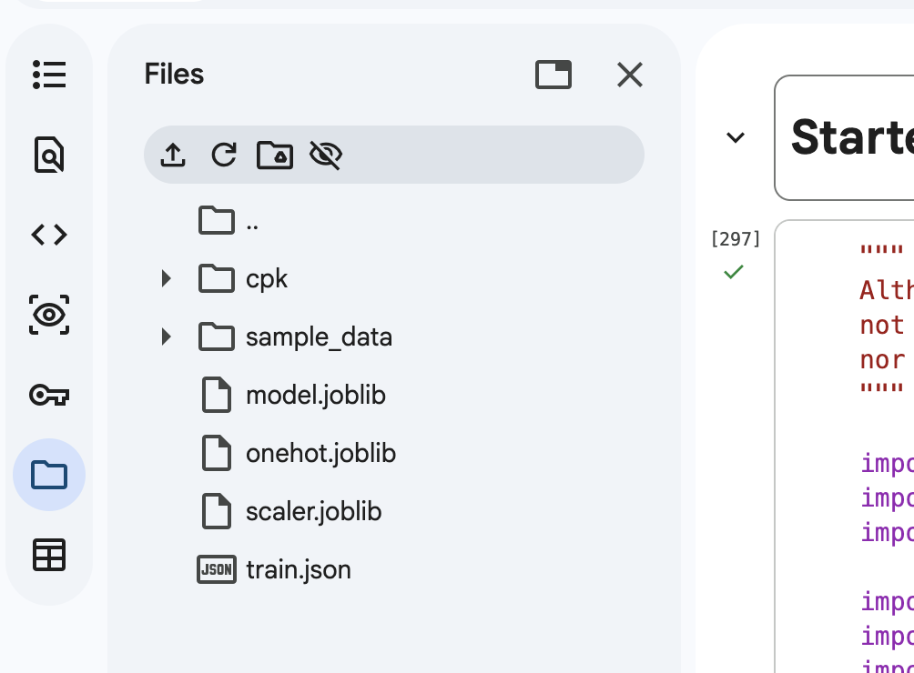

# Lesson 2: The Training and Inference SOP
*AIO / A01-TrainingQuestionFormat*

Every USAAIO trained-model problem follows the same two pipelines. If you memorize this SOP, you can write the skeleton of any problem before you think about the model. This lesson introduces the SOP, then runs it on Sample Problem 5 with **no feature engineering**, the smallest version that works.

## 1. Two Pipelines, One Bridge

**Training SOP** (`Training.ipynb`):

$$
\text{RAW DATA (JSON/CSV)} \to \text{Pandas} \to \text{Feature Engineering} \to \text{NumPy} \to \text{Training} \to \text{Save Model}
$$

**Inference SOP** (`submission.py`, inside `predict(test_path)`):

$$
\text{RAW DATA} \to \text{Pandas} \to \text{Feature Engineering (load)} \to \text{NumPy} \to \text{Load Model} \to \text{Prediction}
$$

![Two-row flowchart. Top row, labeled TRAINING in Training.ipynb: RAW DATA (JSON/CSV), then Pandas DataFrame, then Feature Engineering with fit plus dump and training=True, then NumPy via to_numpy, then Train with model.fit(X, y), then Save Model with joblib.dump. Bottom row, labeled INFERENCE in submission.py predict(test_path), run by the grader on hidden test data: RAW DATA via json.load(test), then Pandas DataFrame, then Feature Engineering with load plus transform and training=False, then NumPy, then Load Model with joblib.load, then Prediction with model.predict(X). Two red dashed arrows go from the top row to the bottom row: one from Feature Engineering carrying scaler.joblib and onehot.joblib, one from Save Model carrying model.joblib. A note says these files are downloaded, uploaded, and put in the ZIP, and every dumped file ships with submission.py.](./images/training-inference-sop.svg)

The two rows are **mirror images**. The only differences:

| Step | Training | Inference |
|---|---|---|
| Raw data | `train.json` (has `y`) | `test_path` from the grader (no `y`) |
| Feature engineering | **fit** preprocessors, **save** them | **load** saved preprocessors, transform only |
| Model | `model.fit(...)`, then `joblib.dump` | `joblib.load`, then `model.predict(...)` |

The `.joblib` files are the **only** thing that crosses from training to inference. Nothing else survives (see [Lesson 1, Section 4](./01-usaaio-trained-model-rules-and-cheat-sheet.md#4-how-the-grader-scores-you)).

## 2. Why Each Step Exists

1. **RAW DATA → Pandas.** JSON loads as a Python `dict` of lists. `pd.DataFrame(data)` turns it into a table with named columns. Named columns make feature engineering readable (`df["x"] ** 2` instead of `X[:, 0] ** 2`).
2. **Feature Engineering (in Pandas).** Add, scale, and encode columns. Do this while you still have column names. Covered in [Lesson 3](./03-feature-engineering-scaler-and-onehot.md).
3. **Pandas → NumPy.** Models want a plain numeric array. Convert with `.to_numpy()` **as late as possible**, right before the model.
4. **Training.** `model.fit(X_train, y_train)`, then check the error on the validation set.
5. **Save Model.** `joblib.dump(model, "model.joblib")` (cheat sheet, Section 4). Download it.

Why not go straight from JSON to NumPy? The original starter code does this:

```python
x_raw = np.array(data_train["x"], dtype=np.float32).reshape(-1, 1)
```

It works for one column, but once you need to add `x^2`, scale some columns, and one-hot others, index arithmetic on a NumPy array becomes error-prone. Stay in Pandas until the model needs NumPy.

## 3. Core Template

**Training.ipynb**

```python
# 1. RAW DATA -> Pandas
with open(train_path, "r") as f:
    data_train = json.load(f)
df = pd.DataFrame(data_train)
x_raw = df[["x"]]          # double brackets: keep it a 2-D DataFrame
y_raw = df["y"]            # single brackets: 1-D Series

# 2. Split: test 20%, then validation 25% of the rest  ->  60 / 20 / 20
from sklearn.model_selection import train_test_split
x_train_val, x_test, y_train_val, y_test = train_test_split(x_raw, y_raw, test_size=0.2, random_state=42)
x_train, x_val, y_train, y_val = train_test_split(x_train_val, y_train_val, test_size=0.25, random_state=42)

# 3. (Feature engineering goes here, see Lesson 3)

# 4. Pandas -> NumPy
x_train_np, y_train_np = x_train.to_numpy(), y_train.to_numpy()
x_val_np,   y_val_np   = x_val.to_numpy(),   y_val.to_numpy()

# 5. Train + validate
from sklearn.linear_model import LinearRegression
model = LinearRegression()
model.fit(x_train_np, y_train_np)
print(np.abs(y_val_np - model.predict(x_val_np)).mean())

# 6. Save
joblib.dump(model, "model.joblib")
```

**submission.py** (written with `%%writefile submission.py` in Inference.ipynb)

```python
import json, joblib
import pandas as pd

def predict(test_path):
    with open(test_path, "r", encoding="utf-8") as f:
        data = json.load(f)
    df = pd.DataFrame(data)              # RAW -> Pandas
    x_raw = df[["x"]]                    # same columns as training
    # (load feature engineering here, see Lesson 3)
    x = x_raw.to_numpy()                 # Pandas -> NumPy
    model = joblib.load("model.joblib")  # Load Model
    return model.predict(x)              # Prediction
```

Details that matter:

- `df[["x"]]` vs. `df["x"]`: scikit-learn expects `X` to be 2-D, shape $(n, 1)$. `df["x"]` is 1-D, shape $(n,)$, and `fit` will raise an error.
- The column selection in `predict` must match training **exactly**: same columns, same order.
- `joblib.load("model.joblib")` uses a relative path. It works because Self-check and the grader unzip your package into the current directory.

### Data Conversion Cheat Block

The four conversions you will use in every problem. Print `.shape` / `.head()` after each one.

```python
import json
import numpy as np
import pandas as pd

# 1. CSV file -> Pandas
df = pd.read_csv("train.csv")                # first row is used as column names
print(df.head(), df.shape)

# 2. JSON -> Pandas
with open("train.json", "r") as f:
    data = json.load(f)                      # dict of lists, or list of dicts
df = pd.DataFrame(data)                      # both layouts work
# (a JSON file can also be read directly: pd.read_json("train.json"))

# 3. Pandas -> NumPy
x_np = df[["x"]].to_numpy()                  # DataFrame (n, 1) -> ndarray (n, 1)
y_np = df["y"].to_numpy()                    # Series (n,)      -> ndarray (n,)

# 4. NumPy -> Pandas
df_x = pd.DataFrame(x_np, columns=["x"])     # give the columns names again
s_y  = pd.Series(y_np, name="y")             # 1-D array -> Series
```

Details that matter:

- **Dict of lists vs. list of dicts.** `{"x": [1, 2], "y": [3, 4]}` and `[{"x": 1, "y": 3}, {"x": 2, "y": 4}]` both become the same 2-row DataFrame with `pd.DataFrame(data)`. Print `type(data)` and `data.keys()` first to see which you have.
- **Column names are lost going to NumPy.** When you convert back, pass `columns=[...]` yourself, in the same order as the array's columns.
- **Index alignment.** After `train_test_split`, a DataFrame keeps its original row labels (e.g. 17, 3, 42). When you rebuild a DataFrame from NumPy the index restarts at 0, so do not `concat` or assign a rebuilt column back to the old DataFrame without `index=old_df.index` (or `.reset_index(drop=True)` on both).
- **Model outputs are NumPy.** `model.predict(x)` returns an `ndarray`, so use conversion 4 whenever you need to put predictions next to the original columns.

## 4. Class Practice 1: Minimum Hands-On, Sample Problem 5

Goal: run the whole flow once, end to end, and get a ZIP that passes Self-check. **No feature engineering.** Still follow JSON → Pandas → NumPy. For now we do **not** care how low the MSE is, only that every step runs through.

Guided notebooks: [Sample problem 5 Guided Minimum](./AIO_Sample_Problem/Sample%20problem%205%20Guided%20Minimum/)

**Step 1. Copy the folder to your local computer.** Copy `Sample problem 5 Guided Minimum` (it contains `Starter code/Training.ipynb`, `Starter code/Inference.ipynb`, and `Self-check.ipynb`).

**Step 2. Create the Training notebook on Colab.** Go to [colab.research.google.com](https://colab.research.google.com), choose **File → Upload notebook**, and upload `Training.ipynb`.

**Step 3. Follow the comments and fill in your code.** Every `# YOUR CODE HERE` has a comment above it that says what to write. Use the [cheat sheet](./01-usaaio-trained-model-rules-and-cheat-sheet.md) when a comment points to it. Run the cells from top to bottom. The data download cell loads `train.json`; look at what it contains (`print` it) and decide how to build `x_raw` and `y_raw`.

**Step 4. Run your code on Colab.** After the last cell, the Colab session contains your model checkpoint file `model.joblib`.

**Step 5. Download the model file to your local computer.** Open the **Files** panel (folder icon on the left sidebar). Click the refresh button if the file is not listed, then right-click `model.joblib` → **Download**.



(`onehot.joblib` and `scaler.joblib` in the screenshot come from Lesson 3. In this practice you only have `model.joblib`.)

**Step 6. Write the Inference notebook.** Upload `Inference.ipynb` to Colab the same way. Fill in the body of `predict(test_path)` following the comments, mirroring what you did in training: same columns, then `.to_numpy()`, then load the model and return the predictions.

**Step 7. Upload `model.joblib` and create the ZIP.** Run the upload cell and select the `model.joblib` you downloaded in Step 5. Then fill in the ZIP cell so that `submission.py` and `model.joblib` go into `TestID_LastName_FirstName.zip`. Run it, then run the last cell to download the ZIP to your computer.

**Step 8. Run Self-check.** Upload `Self-check.ipynb` to Colab, run all cells, and upload your ZIP when asked. It downloads the validation data, calls your `predict`, and prints the MSE. 

**Done when** Self-check runs from the first cell to the last without errors and prints an MSE. If it errors, read the message and go back to the matching step (see Section 5, Common Mistakes).

<details>
<summary>Solution</summary>

Full solution notebooks: [Sample problem 5 Solution Minimum](./AIO_Sample_Problem/Sample%20problem%205%20Solution%20Minimum/)

- [Training.ipynb](./AIO_Sample_Problem/Sample%20problem%205%20Solution%20Minimum/Starter%20code/Training.ipynb): JSON → `pd.DataFrame` → `df[["x"]]`, `df["y"]` → two `train_test_split` calls (60/20/20) → `.to_numpy()` → `LinearRegression().fit` → MAE on train and validation → `joblib.dump(model, "model.joblib")`.
- [Inference.ipynb](./AIO_Sample_Problem/Sample%20problem%205%20Solution%20Minimum/Starter%20code/Inference.ipynb): `submission.py` exactly as in the Core Template. ZIP cell:

```python
zip_name = "TestID_LastName_FirstName.zip"
with zipfile.ZipFile(zip_name, 'w') as f:
    f.write("submission.py")
    f.write("model.joblib")
```

Result: validation MSE $\approx 0.477$ with `random_state=42`. It works, but a straight line through $(x, y)$ is not enough for this data. Lesson 3 adds features and brings it down to $\approx 0.388$.

</details>

## 5. Common Mistakes

### 5.1 Converting to NumPy too early
Once the data is a NumPy array you lose column names, and feature engineering turns into index bookkeeping. Convert right before `fit` / `predict`.

### 5.2 Different columns in training and inference
If training used `df[["x"]]` but `predict` uses `df[["x", "id"]]`, the model gets the wrong number of features and crashes, or worse, quietly predicts garbage.

### 5.3 Training inside `predict`
`predict` must **load** the model, not re-fit it. The test data has no `y`, and re-fitting on every call is not your trained submission.

### 5.4 Forgetting to download
Colab files disappear when the runtime resets. Download every `.joblib` right after training, then upload them in Inference.ipynb before zipping.

## Key Takeaways

- Training: RAW → Pandas → Feature Eng. → NumPy → Train → **Save**.
- Inference: RAW → Pandas → Feature Eng. (**load**) → NumPy → **Load** Model → Predict.
- Stay in Pandas for feature engineering; convert to NumPy right before the model.
- `.joblib` files are the only bridge. Every file you `dump` must go into the ZIP.
- Get the minimum version passing Self-check **first**, then improve the score.

Next lesson: filling in the feature engineering step with `StandardScaler` and `OneHotEncoder`, and saving and loading the preprocessors correctly.
