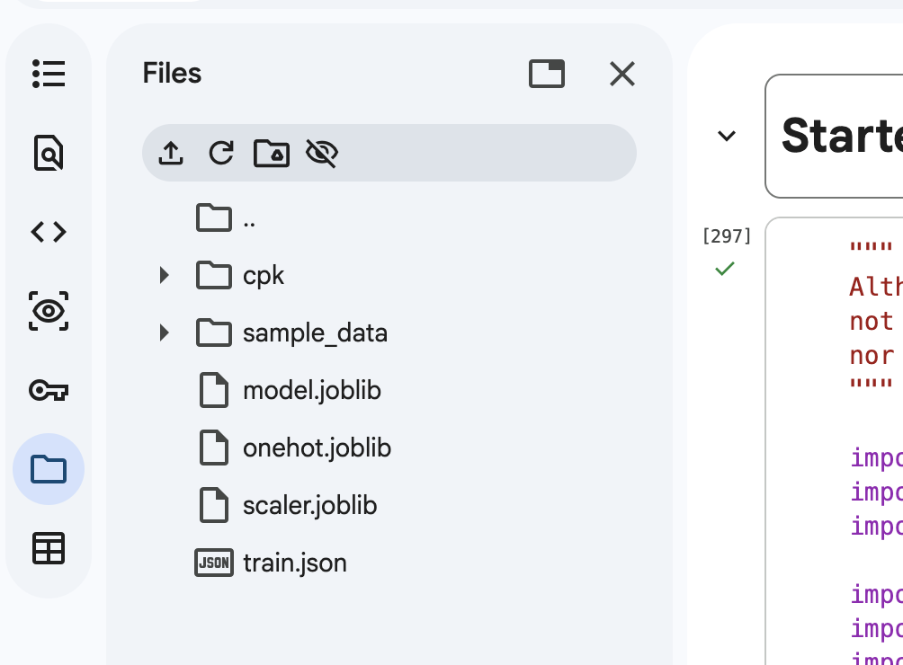

# Lesson 3: Feature Engineering with StandardScaler and OneHotEncoder
*AIO / A01-TrainingQuestionFormat*

[Lesson 2](./02-training-and-inference-sop.md) left the Feature Engineering step empty. This lesson fills it in with hand-written functions built on `StandardScaler` and `OneHotEncoder`, and shows the one rule that matters most: **fit and save the preprocessor during training, load it during validation and testing.**

## 1. What Feature Engineering Is

Feature engineering means changing the input columns **before** they reach the model so the model has an easier job. Three typical moves:

| Move | Example | Why |
|---|---|---|
| **Add** a column | `x^2`, `x > 0` | A linear model can only draw straight lines. Giving it $x^2$ lets it fit a curve. |
| **Scale** a numeric column | `StandardScaler` on `x`, `x^2` | Puts columns on the same scale (mean 0, std 1). |
| **Encode** a category column | `OneHotEncoder` on `positive` | Models need numbers, not `True`/`False` or strings. |

In Sample Problem 5 this takes the validation MSE from $\approx 0.477$ (no features, Lesson 2) to $\approx 0.388$.

## 2. Why We Write It Ourselves (No `ColumnTransformer`)

scikit-learn has `ColumnTransformer` and `Pipeline`, which bundle all of this into one object. We **don't** use them here:

- Their syntax is **not on the cheat sheet**, and in the contest you cannot Google it ([Lesson 1](./01-usaaio-trained-model-rules-and-cheat-sheet.md#1-the-most-important-rule-no-google-no-ai)).
- One mistyped tuple inside `ColumnTransformer([...])` and you are stuck with no reference.
- The hand-written version uses only things you already need anyway: `fit`, `transform`, `joblib.dump`, `joblib.load`, and basic pandas column operations.

**One small function per preprocessor**, each with a `training` flag. That's the whole design.

## 3. StandardScaler

**Concept.** For each column, learn the mean $\mu$ and standard deviation $\sigma$ from the **training** data, then replace every value with

$$
z = \frac{x - \mu}{\sigma}
$$

After scaling, the training column has mean $0$ and standard deviation $1$.

- `fit(X)`: compute and store $\mu$ (`scaler.mean_`) and $\sigma$ (`scaler.scale_`).
- `transform(X)`: apply the formula using the **stored** $\mu$, $\sigma$.
- Output: a NumPy array. Column names come back from `scaler.get_feature_names_out()`, and for a scaler they are the same as the input names.

```python
from sklearn.preprocessing import StandardScaler

scaler = StandardScaler()
scaler.fit(x_train[["x", "x^2"]])         # learn mu, sigma from TRAINING data
z = scaler.transform(x_train[["x", "x^2"]])  # NumPy array
```

This exact pattern, including `joblib.dump(scaler, ...)`, is on the cheat sheet (Section 4, Example 1).

## 4. OneHotEncoder

**Concept.** Turn a category column into one 0/1 column **per category** seen during training.

```text
positive          positive_False  positive_True
--------          --------------  -------------
False      --->        1               0
True       --->        0               1
False      --->        1               0
```

- `fit(X)`: record the list of categories (`onehot.categories_`).
- `transform(X)`: output a **sparse** matrix (`csr_matrix`). Call `.toarray()` to get a normal NumPy array.
- Output names: `onehot.get_feature_names_out()` → `['positive_False', 'positive_True']`.

```python
from sklearn.preprocessing import OneHotEncoder

onehot = OneHotEncoder()
onehot.fit(x_train[["positive"]])
arr = onehot.transform(x_train[["positive"]]).toarray()
```

`OneHotEncoder` is **not** on the cheat sheet. Memorize these three pieces: `fit`, `.toarray()`, `get_feature_names_out()`.

## 5. The Golden Rule: Fit and Save in Training, Load in Validation and Testing

> **Training data:** `fit` the preprocessor, then **`joblib.dump`** it.
> **Validation / test / grader data:** **`joblib.load`** the preprocessor, then `transform` only. **Never `fit` again.**

Why:

- The model learned its weights on data scaled with the **training** $\mu$, $\sigma$. Test data must be scaled with the **same** numbers, or the model receives inputs on a different scale from the ones it learned.
- Re-fitting on test data is **data leakage**, and on the grader's side it is not even possible to do correctly, because `predict` may receive a small batch whose mean is meaningless.
- `predict` runs in a fresh process ([Lesson 1, Section 4](./01-usaaio-trained-model-rules-and-cheat-sheet.md#4-how-the-grader-scores-you)). The fitted scaler only exists there if you saved it to `scaler.joblib` and put that file in the ZIP.

Using the **same function** with a `training` flag for training, validation and inference guarantees the three paths stay identical:

```python
x_train = feature_eng(x_train, training=True)    # fit + dump
x_val   = feature_eng(x_val,   training=False)   # load + transform
# inside predict():  feature_eng(x_raw, training=False)
```

See the bridge arrows in the [SOP diagram](./02-training-and-inference-sop.md#1-two-pipelines-one-bridge).

## 6. Core Template

```python
def apply_scaler(x, column_names, training=True):
  scaler = StandardScaler()
  if training:
    scaler.fit(x[column_names])
    joblib.dump(scaler, "scaler.joblib")
  else:
    scaler = joblib.load("scaler.joblib")

  # The output is np array, convert it back to pandas
  scaled_columns_np = scaler.transform(x[column_names])

  output_column_names = scaler.get_feature_names_out()
  x = x.drop(columns = column_names)

  x[output_column_names] = pd.DataFrame(
      scaled_columns_np,
      columns=output_column_names,
      index=x.index
  )

  return x
```

`apply_onehot` is the same shape with three changes: `OneHotEncoder()` instead of `StandardScaler()`, file name `onehot.joblib`, and `.toarray()` on the transform output.

The five steps, in order:

1. **if training**: `fit` + `dump`. **else**: `load`.
2. `transform` the selected columns, giving NumPy (or sparse) output.
3. Get the output column names with `get_feature_names_out()`.
4. **Drop** the original columns.
5. **Add** the new columns back as a DataFrame with `index=x.index`.

## 7. Reading Example: Why `index=x.index` Matters

After `train_test_split`, the rows keep their **original** index labels, so they come out shuffled, like `7, 3, 9, 0`. A freshly built `pd.DataFrame(array)` gets the index `0, 1, 2, 3`. Pandas aligns by **index label**, not by position:

```python
x = pd.DataFrame({"x": [-2.0, -1.0, 1.0, 2.0]}, index=[7, 3, 9, 0])
x["x^2"] = x["x"] ** 2
x["positive"] = x["x"] > 0

scaler = StandardScaler().fit(x[["x", "x^2"]])
z = scaler.transform(x[["x", "x^2"]])
x2 = x.drop(columns=["x", "x^2"])

# WRONG: no index
x2[["x", "x^2"]] = pd.DataFrame(z, columns=["x", "x^2"])
```

```text
   positive         x  x^2
7     False       NaN  NaN     <- label 7 not in 0..3
3     False  1.264911  1.0     <- got row 3's value (belongs to label 0!)
9      True       NaN  NaN
0      True -1.264911  1.0     <- got row 0's value (belongs to label 7!)
```

With `index=x.index` every value lands on its own row:

```text
   positive         x  x^2
7     False -1.264911  1.0
3     False -0.632456 -1.0
9      True  0.632456 -1.0
0      True  1.264911  1.0
```

No error is raised in the wrong version. You just get NaNs and scrambled rows, so always pass `index=x.index`.

## 8. Class Practice 1: Feature Engineering for Sample Problem 5

Goal: add feature engineering to the minimum flow from [Lesson 2](./02-training-and-inference-sop.md#4-class-practice-1-minimum-hands-on-sample-problem-5), and run it end to end through Self-check. The target is that everything runs and produces all four files (`model.joblib`, `scaler.joblib`, `onehot.joblib`, and the ZIP). The MSE is not graded yet.

Guided notebooks: [Sample problem 5 Guided FeatureEng](./AIO_Sample_Problem/Sample%20problem%205%20Guided%20FeatureEng/)

**Step 1. Copy the folder to your local computer.** Copy `Sample problem 5 Guided FeatureEng` (`Starter code/Training.ipynb`, `Starter code/Inference.ipynb`, `Self-check.ipynb`).

**Step 2. Create the Training notebook on Colab.** Go to [colab.research.google.com](https://colab.research.google.com), choose **File → Upload notebook**, and upload `Training.ipynb`.

**Step 3. Follow the comments and fill in your code.** The data loading, splitting and model cells work like Lesson 2. The new part is the **Feature Engineering** cell: write `add_columns`, `apply_scaler`, `apply_onehot`, and `feature_eng` following the comments (Section 6 is your reference), then call `feature_eng` on `x_train` with `training=True` and on `x_val` with `training=False`. Print `x_train` and `x_val` to check the columns and look for NaN (Section 7).

**Step 4. Run your code on Colab.** After the last cell, the Colab session contains three checkpoint files: `model.joblib`, `scaler.joblib`, and `onehot.joblib`.

**Step 5. Download all three `.joblib` files to your local computer.** Open the **Files** panel (folder icon on the left sidebar), click refresh if needed, and right-click each file → **Download**. This time there are **three** files to download, not one.



**Step 6. Write the Inference notebook.** Upload `Inference.ipynb` to Colab. Copy your four feature functions (and the imports they need) into `submission.py` above `predict`, then fill in `predict` using `feature_eng(x_raw, training=False)`.

**Step 7. Upload the three `.joblib` files and create the ZIP.** Run the upload cell and select all three files. Fill in the ZIP cell so that `submission.py`, `model.joblib`, `scaler.joblib`, and `onehot.joblib` all go into `TestID_LastName_FirstName.zip`, then download the ZIP.

**Step 8. Run Self-check.** Upload `Self-check.ipynb` to Colab, run all cells, and upload your ZIP when asked.

**Done when** Self-check runs from the first cell to the last without errors and prints an MSE. If it errors, see Section 9, Common Mistakes.

<details>
<summary>Solution</summary>

Full solution notebooks: [Sample problem 5 Solution FeatureEng](./AIO_Sample_Problem/Sample%20problem%205%20Solution%20FeatureEng/)

```python
def add_columns(x):
  x["x^2"] = x["x"] ** 2
  x["positive"] = x["x"] > 0
  return x

def apply_onehot(x, column_names, training=True):
  onehot = OneHotEncoder()
  if training:
    onehot.fit(x[column_names])
    joblib.dump(onehot, "onehot.joblib")
  else:
    onehot = joblib.load("onehot.joblib")

  # The output is csr array, convert it back to pandas
  onehot_columns_np = onehot.transform(x[column_names])

  x = x.drop(columns = column_names)
  output_column_names = onehot.get_feature_names_out()
  x[output_column_names] = pd.DataFrame(
      onehot_columns_np.toarray(),
      columns=output_column_names,
      index = x.index
  )
  return x

def feature_eng(x, training=True):
  x = add_columns(x)
  x = apply_scaler(x, ["x", "x^2"], training)   # from Section 6
  x = apply_onehot(x, ["positive"], training)
  return x
```

Column order: start `[x, x^2, positive]` → scaler drops `x, x^2` and re-adds them at the end → `[positive, x, x^2]` → one-hot drops `positive` and adds two columns → `[x, x^2, positive_False, positive_True]`.

Changes in [Inference.ipynb](./AIO_Sample_Problem/Sample%20problem%205%20Solution%20FeatureEng/Starter%20code/Inference.ipynb):

- Copy `add_columns`, `apply_scaler`, `apply_onehot`, `feature_eng` (and their imports) into `submission.py` **above** `predict`.
- In `predict`: `x = feature_eng(x_raw, training=False).to_numpy()`.
- Add `onehot.joblib` and `scaler.joblib` to the ZIP next to `submission.py` and `model.joblib`.

Validation MSE drops from $\approx 0.477$ to $\approx 0.388$.

</details>

## 9. Common Mistakes

### 9.1 Calling `fit` or `fit_transform` on validation or test data
The model then gets inputs scaled with different numbers from the ones it was trained on. Always go through `training=False`.

### 9.2 Forgetting `index=x.index`
Silent NaNs and scrambled rows (Section 7).

### 9.3 Forgetting `.toarray()` on the one-hot output
`OneHotEncoder.transform` returns a sparse matrix. `pd.DataFrame(sparse, columns=[...])` crashes with `ValueError: Shape of passed values is (n, 1), indices imply (n, 2)`, because pandas treats the sparse matrix as a single object, not a table. Call `.toarray()` first.

### 9.4 Feature code exists only in the Training notebook
`submission.py` is a separate file. Every helper function it calls must be copied into it, along with its imports.

### 9.5 Preprocessor files missing from the ZIP
Training wrote `scaler.joblib` and `onehot.joblib`, so both must be uploaded and zipped. Self-check fails with `FileNotFoundError` otherwise.

### 9.6 A category the encoder never saw
If test data contains a category that was not in training, `OneHotEncoder()` raises an error at `transform`. When this can happen (string categories), use `OneHotEncoder(handle_unknown="ignore")`, which outputs all zeros for unseen categories.

## Key Takeaways

- Feature engineering = add, scale, encode columns, done in **Pandas** before `.to_numpy()`.
- Write one small function per preprocessor with a `training` flag. No `ColumnTransformer`, since it is not on the cheat sheet.
- **Training: fit + `joblib.dump`. Validation / test / `predict`: `joblib.load` + transform only.**
- Rebuild the DataFrame with `get_feature_names_out()`, `drop`, and `index=x.index`. One-hot output needs `.toarray()`.
- Copy the feature functions into `submission.py` and put every `.joblib` in the ZIP.
