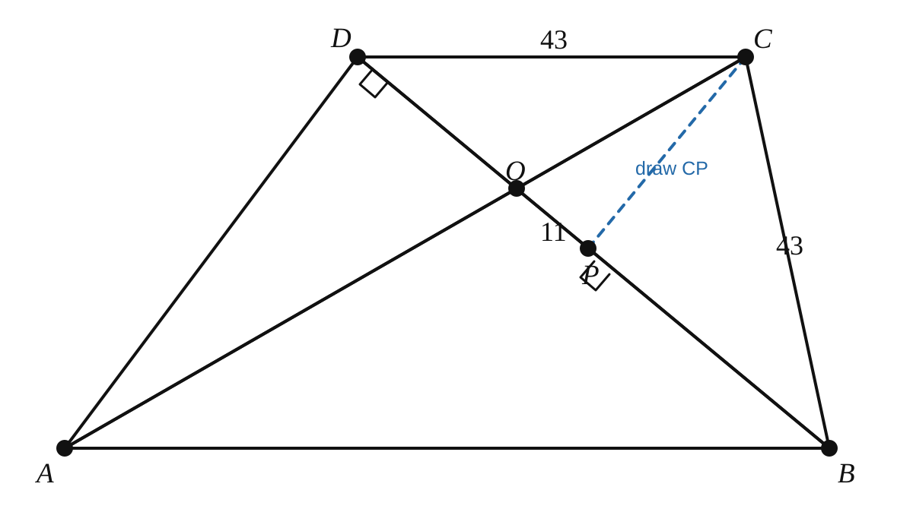

# AMC 10 2021 A, Problem 17 — Do Not Leave a Midpoint Orphaned

## Question

Trapezoid $ABCD$ has $\overline{AB}\parallel\overline{CD}$, $BC=CD=43$, and
$\overline{AD}\perp\overline{BD}$. Let $O$ be the intersection of the diagonals
$\overline{AC}$ and $\overline{BD}$, and let $P$ be the midpoint of
$\overline{BD}$. Given that $OP=11$, the length of $AD$ can be written in the
form $m\sqrt{n}$, where $m$ and $n$ are positive integers and $n$ is not
divisible by the square of any prime. What is $m+n$?

\[
\text{(A) }65\qquad
\text{(B) }132\qquad
\text{(C) }157\qquad
\text{(D) }194\qquad
\text{(E) }215
\]

## Key Visualization

In the raw diagram, midpoint $P$ is an **orphan**: it lies on its given segment, but no useful new segment has been drawn from it. That leaves the midpoint information isolated, so it is easy to overlook what it can tell us.

Draw $\overline{CP}$ (shown dotted in blue). Now $P$ participates in the relevant triangles rather than merely sitting on its original line. Its midpoint property can be used together with the surrounding right angles and parallel sides.

The habit to carry forward is simple: whenever a problem gives a midpoint, ask, “What segment should I draw from it?” A midpoint is often an invitation to create a median, a pair of related triangles, or a useful similarity/congruence relationship.

This note intentionally stops at the diagram move; the point is to recognize and activate the midpoint, not to finish the full problem.
