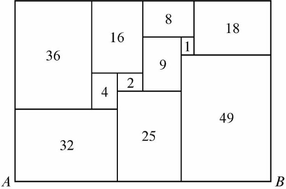

# AMC 10 2024 A, Problem 16 — Do Not Guess the Aspect Ratio

## Question

> All of the rectangles in the figure below, which is drawn to scale, are
> similar to the enclosing rectangle. Each number represents the area of its
> rectangle. What is length $AB$?

\[
\text{(A) }4+4\sqrt5\qquad
\text{(B) }10\sqrt2\qquad
\text{(C) }5+5\sqrt5\qquad
\text{(D) }10\sqrt[4]{8}\qquad
\text{(E) }20
\]

## Key Observation

Every small rectangle has the same aspect ratio as the enclosing rectangle.
Let

\[
\rho=\frac{\text{long side}}{\text{short side}}.
\]

For a rectangle of area $A$, its short and long sides are, respectively,

\[
\sqrt{\frac{A}{\rho}}
\qquad\text{and}\qquad
\sqrt{A\rho}.
\]

Now use the two ways to measure the full width of the enclosing rectangle.
Reading the left edge and the right edge of the diagram gives

\[
\sqrt{36\rho}+\sqrt{\frac{32}{\rho}} = \sqrt{49\rho}+\sqrt{\frac{18}{\rho}}
\]

This is the equation that determines $\rho$. Once the aspect ratio is known,
the total area of the labeled rectangles can connect $\rho$ to $AB$.

## Pitfall

Because the diagram is drawn to scale, it is tempting to guess a friendly
fraction for the aspect ratio and test it. That is unreliable and obscures the
structure. Introduce $\rho$ first, translate every labeled area into side
lengths, and let the two full-width expressions force the ratio.
