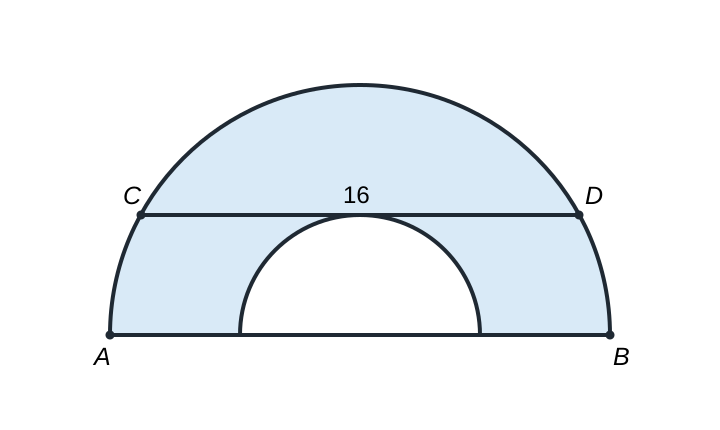

# AMC 10 2025 A, Problem 10 — Let the Unspecified Radius Collapse

## Question

> A semicircle has diameter $\overline{AB}$ and chord $\overline{CD}$ of length
> $16$ parallel to $\overline{AB}$. A smaller semicircle with diameter on
> $\overline{AB}$ and tangent to $\overline{CD}$ is cut from the larger
> semicircle, as shown below. What is the area of the resulting figure, shown
> shaded?

\[
\text{(A) }16\pi\qquad
\text{(B) }24\pi\qquad
\text{(C) }32\pi\qquad
\text{(D) }48\pi\qquad
\text{(E) }64\pi
\]

## Key Visualization

The radius of the small semicircle is not given. That is a signal that the
answer should not depend on it. Rather than introduce an unnecessary variable,
slide to the extreme case: let the small radius shrink to $0$. Then the chord
$\overline{CD}$ becomes the diameter of the remaining semicircle, so that
diameter is $16$ and its radius is $8$.

Therefore the shaded area is

\[
\frac12\pi(8)^2=\boxed{32\pi}.
\]

The limiting picture is not a guess. If the small radius is $r$, the chord is
$r$ units above $\overline{AB}$. Its half-length is $8$, so the radius $R$ of
the large semicircle satisfies

\[
R^2=r^2+8^2.
\]

Thus the difference of the two semicircle areas is always

\[
\frac12\pi(R^2-r^2)=\frac12\pi\cdot64=32\pi,
\]

which confirms that collapsing the unspecified radius preserves the result.

When a parameter is missing from a contest diagram, first ask whether the
quantity being requested is invariant. If it is, an extreme or degenerate case
can make the geometry immediate.
