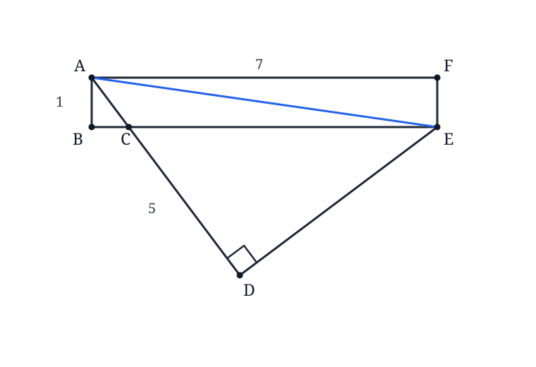

# AMC 10 2025 A, Problem 15 — Let the Right Angle Draw the Semicircle

## Question

> In the figure below, $ABEF$ is a rectangle, $AD\perp DE$, $AF=7$,
> $AB=1$, and $AD=5$. What is the area of $\triangle ABC$?

\[
\text{(A) }\frac38\qquad
\text{(B) }\frac49\qquad
\text{(C) }\frac18\sqrt{13}\qquad
\text{(D) }\frac7{15}\qquad
\text{(E) }\frac18\sqrt{15}
\]

## Key Visualization

It is tempting to treat $AD\perp DE$ as only a local angle fact at $D$. That
leaves the given right angle disconnected from the rectangle.

Instead, draw the auxiliary segment $\overline{AE}$. Since $\angle ADE=90^\circ$,
point $D$ lies on the semicircle with diameter $\overline{AE}$ (Thales's theorem).
The added diagonal completes the picture: it links the right triangle $ADE$ to the
rectangle and exposes the useful structure at once.

The key habit is: when a right angle is formed by two segments ending at known
points, connect those endpoints and ask whether the right-angle vertex lies on a
circle with that new segment as a diameter. Stop there before doing any length or
area calculations.
