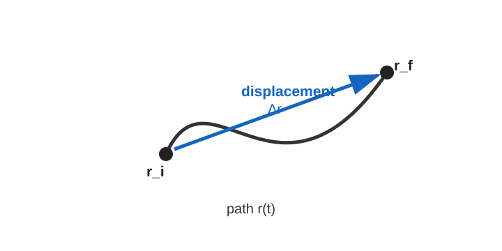
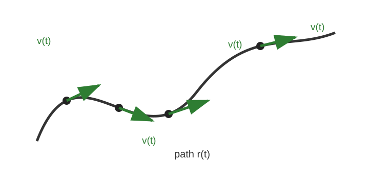
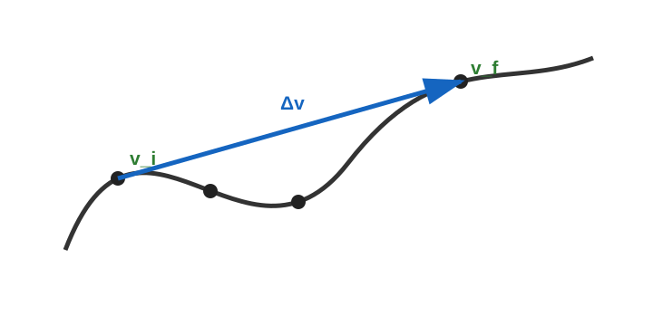
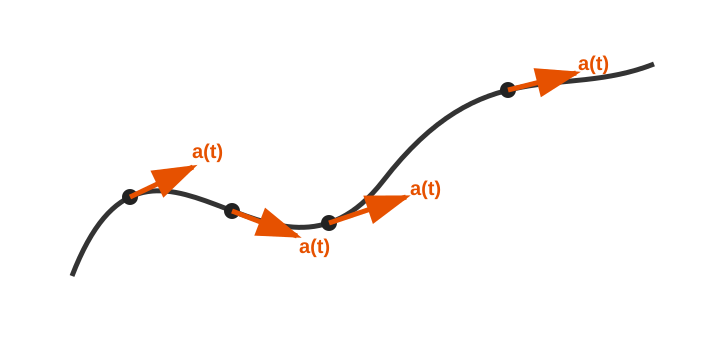
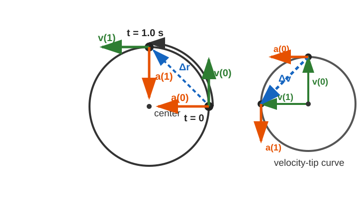

# Average and Instantaneous Velocity and Acceleration
*AP Physics / Misc*

> **Core idea:** Average quantities describe an entire time interval. Instantaneous quantities describe one moment. Velocity and acceleration are vectors, so a change in direction counts as a change even if speed is constant.

## 1. Definitions and units

Let an object move from time $t_i$ to $t_f$. Its displacement is

$$
\Delta\vec r=\vec r_f-\vec r_i,
\qquad
\Delta t=t_f-t_i.
$$

**Definition (Average velocity).** The displacement per elapsed time is

$$
\boxed{\vec v_{\mathrm{avg}}=\frac{\Delta\vec r}{\Delta t}}.
$$

Its SI unit is meters per second, $\mathrm{m/s}$. Average velocity is not generally the same as average speed: velocity uses displacement, whereas speed uses total distance traveled.

**Definition (Instantaneous velocity).** The velocity at a particular moment is the limiting rate of change of position:

$$
\boxed{\vec v(t)=\frac{d\vec r}{dt}}\approx \frac{\vec r(t+\delta)-\vec r(t)}{\delta}.
$$

It points tangent to the path. On a position-versus-time graph in one dimension, it is the slope of the tangent line.

**Definition (Average acceleration).** The change in velocity per elapsed time is

$$
\boxed{\vec a_{\mathrm{avg}}=\frac{\Delta\vec v}{\Delta t}
=\frac{\vec v_f-\vec v_i}{\Delta t}}.
$$

To interpret the next two diagrams, imagine placing every instantaneous velocity vector with the same tail. The curve is the imaginary curve formed by their tips in **velocity space**; it is not the object's motion trajectory. For average acceleration, the blue arrow is $\Delta\vec v=\vec v_f-\vec v_i$.

**Definition (Instantaneous acceleration).** The acceleration at a particular moment is

$$
\boxed{\vec a(t)=\frac{d\vec v}{dt}}\approx \frac{\vec v(t+\delta)-\vec v(t)}{\delta}.
$$

On that same imaginary velocity-tip curve, $\vec a(t)=d\vec v/dt$ is tangent to the curve, as shown by the orange arrows.

Both accelerations have SI unit $\mathrm{m/s^2}$. A zero acceleration means velocity is constant as a vector: both its magnitude and direction remain unchanged.

## 2. A reliable calculation routine

1. Mark the initial and final times for an average quantity.
2. Use positions for average velocity: subtract final minus initial position, then divide by $\Delta t$.
3. Use velocities for average acceleration: subtract final minus initial velocity, then divide by $\Delta t$.
4. For an instantaneous quantity, use a very short time interval around the specified time, a motion equation, or the local tangent direction.

Keep the vectors in component form whenever the motion is two-dimensional. Do not divide a distance by time and call it average velocity unless the direction is also accounted for.

## 3. Constant-velocity motion

**Example (Cart moving at constant velocity).** A cart's position along the $x$-axis is

$$
x(t)=2+3t,
$$

where $x$ is in meters and $t$ is in seconds. Find its average velocity and average acceleration from $t=1.0\ \mathrm{s}$ to $t=5.0\ \mathrm{s}$. Then find its instantaneous velocity and instantaneous acceleration at $t=3.0\ \mathrm{s}$.

**Solution:**

The two positions are

$$
x_i=x(1)=5\ \mathrm{m},
\qquad
x_f=x(5)=17\ \mathrm{m}.
$$

Thus the displacement is $\Delta x=12\ \mathrm{m}$ over $\Delta t=4.0\ \mathrm{s}$, so

$$
\boxed{v_{\mathrm{avg}}=\frac{12\ \mathrm{m}}{4.0\ \mathrm{s}}=3.0\ \mathrm{m/s}}.
$$

For the instantaneous velocity at $t=3.0\ \mathrm{s}$, use a small time step $\delta t$:

$$
\frac{x(3.0+\delta t)-x(3.0)}{\delta t}
=\frac{[2+3(3.0+\delta t)]-[2+3(3.0)]}{\delta t}
=3.0\ \mathrm{m/s}.
$$

The result does not depend on how small $\delta t$ is, so

$$
\boxed{v(3.0\ \mathrm{s})=3.0\ \mathrm{m/s}}.
$$

The velocity is $3.0\ \mathrm{m/s}$ throughout the interval, so $v_i=v_f=3.0\ \mathrm{m/s}$ and

$$
\boxed{a_{\mathrm{avg}}=\frac{3.0-3.0}{4.0\ \mathrm{s}}=0\ \mathrm{m/s^2}}.
$$

Over a small time step around $t=3.0\ \mathrm{s}$, the velocity still does not change. Therefore

$$
\boxed{a(3.0\ \mathrm{s})=0\ \mathrm{m/s^2}}.
$$

For constant velocity, average velocity equals instantaneous velocity over every interval, and both average and instantaneous acceleration are zero.

$\square$

## 4. Constant-acceleration motion

**Example (Cart speeding up in one dimension).** At $t=0$, a cart is at $x=0$ and has initial velocity $v_0=4.0\ \mathrm{m/s}$. It then moves with constant acceleration $a=3.0\ \mathrm{m/s^2}$.

Find its average velocity and average acceleration from $t=1.0\ \mathrm{s}$ to $t=3.0\ \mathrm{s}$, then find its instantaneous velocity and acceleration at $t=2.0\ \mathrm{s}$.

**Solution:**

Start with the constant-acceleration position relation:

$$
x(t)=v_0t+\frac12at^2.
$$

Substituting the given values gives

$$
x(t)=(4.0)t+\frac12(3.0)t^2=4.0t+1.5t^2.
$$

The endpoint positions are

$$
x(1)=5.5\ \mathrm{m},
\qquad
x(3)=25.5\ \mathrm{m}.
$$

So

$$
\boxed{v_{\mathrm{avg}}=\frac{25.5-5.5}{3.0-1.0}=10.0\ \mathrm{m/s}}.
$$

For constant acceleration, instantaneous velocity is

$$
v(t)=v_0+at=4.0+3.0t.
$$

Thus, at the requested instant,

$$
\boxed{v(2.0\ \mathrm{s})=4.0+3.0(2.0)=10.0\ \mathrm{m/s}}.
$$

Use the same velocity equation at the endpoints for the average acceleration:

$$
v_i=v(1.0\ \mathrm{s})=4.0+3.0(1.0)=7.0\ \mathrm{m/s},
\qquad
v_f=v(3.0\ \mathrm{s})=4.0+3.0(3.0)=13.0\ \mathrm{m/s}.
$$

Therefore,

$$
\boxed{a_{\mathrm{avg}}=\frac{13.0-7.0}{3.0-1.0}=3.0\ \mathrm{m/s^2}}.
$$

Finally, use a small time step $\delta t$ in the instantaneous-velocity equation to find the instantaneous acceleration at $t=2.0\ \mathrm{s}$:

$$
\frac{v(2.0+\delta t)-v(2.0)}{\delta t}
=\frac{[4.0+3.0(2.0+\delta t)]-[4.0+3.0(2.0)]}{\delta t}
=3.0\ \mathrm{m/s^2}.
$$

Because this result does not depend on the size of the small time step,

$$
\boxed{a(2.0\ \mathrm{s})=3.0\ \mathrm{m/s^2}}.
$$

For one-dimensional constant acceleration, $a_{\mathrm{avg}}=a(t)$ for every interval. Also, the average velocity over an interval equals the instantaneous velocity at the interval's midpoint: here $v_{\mathrm{avg}}=v(2.0\ \mathrm{s})=10.0\ \mathrm{m/s}$.

$\square$

## 5. Constant circular motion: constant speed does not mean zero acceleration

**Example (Uniform circular motion).** A particle moves counterclockwise around a circle of radius $R=10\ \mathrm{m}$, completing one revolution in $T=4.0\ \mathrm{s}$. At $t=0$, it is at $(10,0)\ \mathrm{m}$. 
1. Calculate average velocity and average acceleration vector from $t=0$ to $t=1.0\ \mathrm{s}$, 
2. Calculate the magnitude of average velocity and average acceleration from $t=0$ to $t=1.0\ \mathrm{s}$, 
3. Calculate instantaneous velocity and instantaneous acceleration vector at $t=0$ and $t=1.0\ \mathrm{s}$.
4. Calculate instantaneous velocity and instantaneous acceleration magnitude at $t=0$ and $t=1.0\ \mathrm{s}$.

The smaller circle at right is the velocity-tip curve in velocity space. Its radius equals the speed, $\Delta\vec v$ joins the two velocity tips, and each instantaneous acceleration vector is tangent to this curve.

**Solution:**

The angular speed and constant speed are

$$
\omega=\frac{2\pi}{T}=\frac{\pi}{2}\ \mathrm{rad/s},
\qquad
v=\omega R=5\pi\ \mathrm{m/s}.
$$

After one second, the particle has turned through $\omega(1.0\ \mathrm{s})=\pi/2$, so

$$
\vec r(0)=\langle 10,0\rangle\ \mathrm{m},
\qquad
\vec r(1)=\langle 0,10\rangle\ \mathrm{m}.
$$

The displacement is $\Delta\vec r=\langle -10,10\rangle\ \mathrm{m}$. Hence

$$
\boxed{\vec v_{\mathrm{avg}}=\frac{\langle -10,10\rangle\ \mathrm{m}}{1.0\ \mathrm{s}}
=\langle -10,10\rangle\ \mathrm{m/s}}.
$$

Its magnitude is

$$
\boxed{|\vec v_{\mathrm{avg}}|
=\sqrt{(-10)^2+(10)^2}
=10\sqrt2\ \mathrm{m/s}}.
$$

Instantaneous velocity is tangent to the circle. It has the same magnitude $5\pi\ \mathrm{m/s}$ at both times, but a different direction:

$$
\boxed{\vec v(0)=\langle 0,5\pi\rangle\ \mathrm{m/s}},
\qquad
\boxed{\vec v(1)=\langle -5\pi,0\rangle\ \mathrm{m/s}}.
$$

Therefore,

$$
\boxed{|\vec v(0)|=|\vec v(1)|=5\pi\ \mathrm{m/s}}.
$$

Now use the change in the two velocity vectors:

$$
\boxed{\vec a_{\mathrm{avg}}
=\frac{\langle -5\pi,0\rangle-\langle 0,5\pi\rangle}{1.0\ \mathrm{s}}
=\langle -5\pi,-5\pi\rangle\ \mathrm{m/s^2}}.
$$

Its magnitude is

$$
\boxed{|\vec a_{\mathrm{avg}}|
=\sqrt{(-5\pi)^2+(-5\pi)^2}
=5\pi\sqrt2\ \mathrm{m/s^2}}.
$$

The instantaneous acceleration is centripetal: it points toward the center and has magnitude

$$
a_c=\frac{v^2}{R}=\frac{(5\pi)^2}{10}=2.5\pi^2\ \mathrm{m/s^2}.
$$

Thus,

$$
\boxed{\vec a(0)=\langle -2.5\pi^2,0\rangle\ \mathrm{m/s^2}},
\qquad
\boxed{\vec a(1)=\langle 0,-2.5\pi^2\rangle\ \mathrm{m/s^2}}.
$$

Thus,

$$
\boxed{|\vec a(0)|=|\vec a(1)|=2.5\pi^2\ \mathrm{m/s^2}}.
$$

Even though the **speed** is constant, the velocity changes direction continuously. Therefore the acceleration is not zero. The average acceleration over a finite arc and the instantaneous centripetal acceleration need not point in the same direction.

$\square$

## 6. Quick comparison

| Motion type | Average velocity | Instantaneous velocity | Average acceleration | Instantaneous acceleration |
| --- | --- | --- | --- | --- |
| Constant velocity | Same as the constant velocity | Same at every moment | $0$ | $0$ |
| Constant acceleration in one dimension | Depends on interval; equals midpoint velocity | Changes linearly with time | Same as $a(t)$ | Constant |
| Uniform circular motion | Depends on displacement between endpoints | Tangent to the circle | Depends on the velocity-vector change | Toward the center, magnitude $v^2/R$ |

The decisive question is always whether the **velocity vector** changes. A change in speed, direction, or both produces acceleration.
