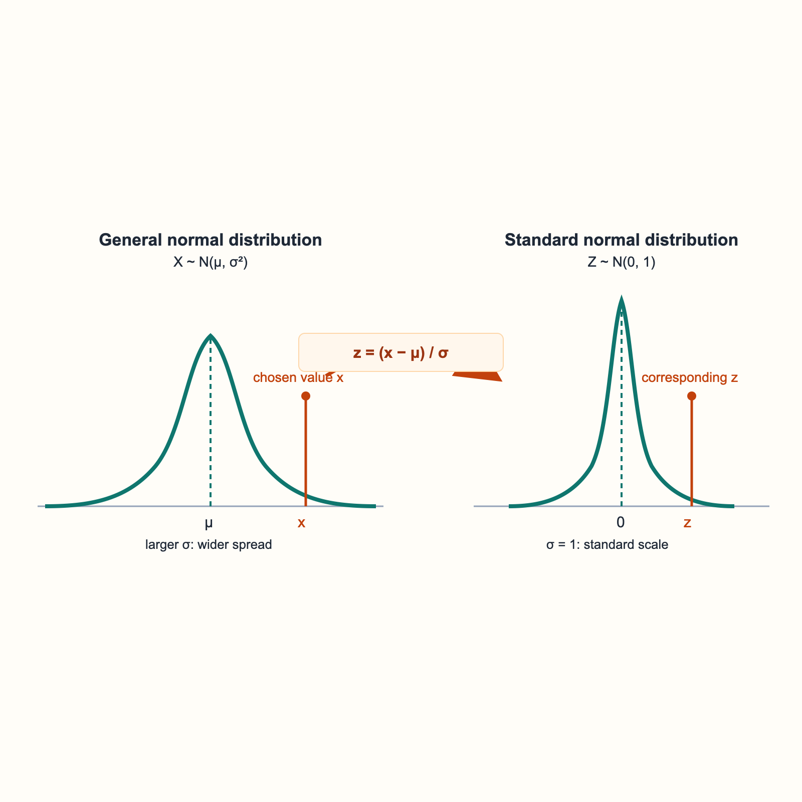

# Normal Distribution: PDF, CDF, and *z*-Scores

Let $X\sim N(\mu,\sigma^2)$, where $\mu$ is the mean and $\sigma>0$ is the standard deviation. The notation $\sigma^2$ is the variance.

## Probability density function (PDF)

The normal PDF is

$$
f_X(x)=\frac{1}{\sigma\sqrt{2\pi}}e^{-\frac{(x-\mu)^2}{2\sigma^2}}.
$$

Its graph is a smooth, symmetric bell curve.

<svg viewBox="0 0 720 330" width="720" role="img" aria-labelledby="normal-pdf-title normal-pdf-desc" xmlns="http://www.w3.org/2000/svg">
  <title id="normal-pdf-title">A normal probability density curve</title>
  <desc id="normal-pdf-desc">A bell-shaped normal density curve centered at mu. The region between X1 and X2 is shaded to represent an interval probability.</desc>
  <rect width="720" height="330" rx="12" fill="#fffdf8"/>
  <g stroke="#94a3b8" stroke-width="1.5"><path d="M65 264H676"/><path d="M370 276V38" stroke-dasharray="5 5"/></g>
  <path d="M175 264 C205 255 232 225 262 167 C292 107 326 64 370 56 C414 64 448 107 478 167 C508 225 535 255 565 264 Z" fill="#ccfbf1" opacity=".95"/>
  <path d="M82 264 C154 264 190 259 220 231 C263 191 291 83 370 56 C449 83 477 191 520 231 C550 259 586 264 658 264" fill="none" stroke="#0f766e" stroke-width="4"/>
  <g stroke="#0f766e" stroke-width="2"><path d="M175 264V255"/><path d="M565 264V255"/></g>
  <g font-family="sans-serif" font-size="17" fill="#1f2937"><text x="665" y="254">x</text><text x="382" y="52">density</text><text x="162" y="286">X₁</text><text x="555" y="286">X₂</text><text x="360" y="286">μ</text></g>
  <text x="260" y="180" font-family="sans-serif" font-size="17" fill="#0f766e">P(X₁ ≤ X ≤ X₂)</text>
  <text x="243" y="312" font-family="sans-serif" font-size="15" fill="#475569">area under the curve = probability</text>
</svg>

- $\mu$ determines the center (and peak location) of the curve. Increasing $\mu$ shifts the whole curve to the right; decreasing it shifts the curve to the left.
- $\sigma$ determines the spread. A larger $\sigma$ makes the curve wider and flatter. A smaller $\sigma$ makes it narrower and taller.
- The total area under every normal PDF is $1$. Areas over intervals represent probabilities. For a continuous random variable, the probability of one exact value is $0$: $P(X=x)=0$.

For example, $P(a\le X\le b)$ is the area under the PDF from $a$ to $b$.

## Cumulative distribution function (CDF)

The CDF gives the area to the left of a value $x$:

$$
F_X(x)=P(X\le x)=\operatorname{cdf}(\mu,\sigma^2,x)
=\int_{-\infty}^{x} f_X(t)\,dt.
$$

Thus, the probability that $X$ falls in an interval is the difference of two left-tail areas:

$$
P(x_1\le X\le x_2)
=F_X(x_2)-F_X(x_1)
=\operatorname{cdf}(\mu,\sigma^2,x_2)-\operatorname{cdf}(\mu,\sigma^2,x_1).
$$

For a continuous normal distribution, using $<$ or $\le$ gives the same probability.

## Standardizing with a *z*-score

All normal curves have the same bell-shaped form; they differ only in center and spread. Before calculators and computers were common, tables could not list CDF values for every possible $\mu$ and $\sigma$. Instead, tables listed values for the **standard normal distribution**:

$$
Z\sim N(0,1).
$$

The diagram shows how a value $x$ on a general normal curve maps to its corresponding $z$-score on the standard normal curve.

Convert Random Variable $X$ from $N(\mu,\sigma^2)$ to standard $N(0,1)$:

$$
Z=\frac{X-\mu}{\sigma}
$$

Convert a value $x$ from $N(\mu,\sigma^2)$ to a standard-normal value by calculating its *z*-score:

$$
z(x)=\frac{x-\mu}{\sigma}.
$$

The *z*-score says how many standard deviations $x$ is above (positive) or below (negative) the mean. Standardization preserves the order of values because $\sigma>0$. Therefore,

$$
P(X<X_1)
=P\!\left(\frac{X-\mu}{\sigma}<\frac{x_1-\mu}{\sigma}\right)
=P\!\left(Z<z(x_1)\right).
$$

Equivalently,

$$
\operatorname{cdf}(\mu,\sigma^2,x_1)
=\operatorname{cdf}(0,1,z(x_1))
=\Phi\!\left(z(x_1)\right),
$$

where $\Phi$ (also written `std_norm_cdf`) is the standard normal CDF.

For an interval, standardize both endpoints:

$$
P(x_1\le X\le x_2)
=\Phi\!\left(\frac{x_2-\mu}{\sigma}\right)
-\Phi\!\left(\frac{x_1-\mu}{\sigma}\right)
=\Phi(z(x_2)) - \Phi(z(x_1))
$$
