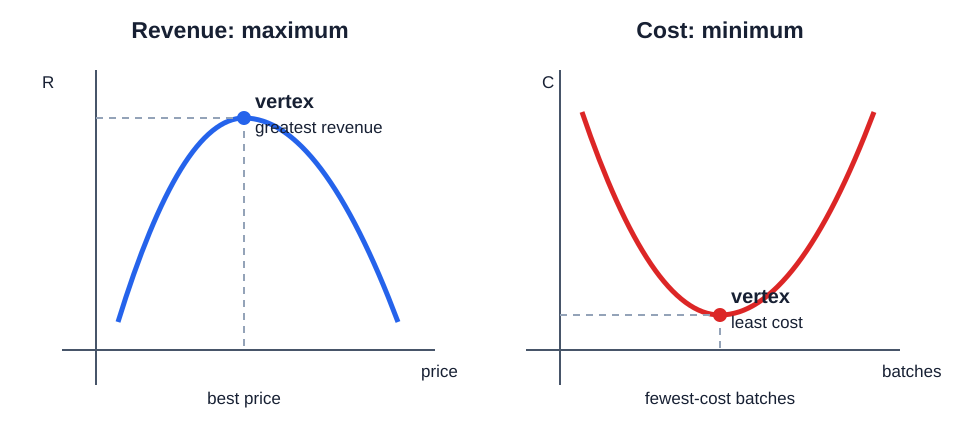

# Lesson 20: Quadratic Extreme-Value Word Problems
*Fundamental Math / Algebra I*

Some quadratic word problems do not ask when a quantity is zero. They ask for the
**greatest** revenue, height, or area, or the **least** cost or value. Those questions are
about the turning point of a parabola: its **vertex**.

## Learning Targets

By the end of class, you should be able to:

- translate an extreme-value situation into a quadratic function;
- decide whether its vertex is a maximum or a minimum;
- find the input at the vertex using $x=-\dfrac{b}{2a}$ or vertex form; and
- state an answer with its meaning and units, then check that it fits the context.

## 1. Two Methods for Finding the Vertex

For a quadratic function

$$f(x)=ax^2+bx+c,$$

there are two equivalent ways to find the vertex.

### Method 1: Use the Vertex Formula

The input coordinate of the vertex is

$$x=\frac{-b}{2a}.$$

Substitute that input back into the function to find the output coordinate.

### Method 2: Complete the Square

Rewrite the quadratic in vertex form:

$$f(x)=a(x-h)^2+k.$$

The vertex is $(h,k)$. To complete the square correctly when the coefficient of $x^2$ is
not $1$, use this routine:

1. **Normalize the quadratic coefficient:** factor $a$ from the $x^2$ and $x$ terms.
2. Inside the parentheses, take half the (now normalized) coefficient of $x$, square it,
   and **add and subtract** that number. In other words, for $x^2+bx$, add and subtract
   $\left(\dfrac b2\right)^2$.
3. Factor the resulting trinomial square, then distribute the outside coefficient.

For example,

$$
\begin{aligned}
2x^2-12x+5&=2(x^2-6x)+5\\
&=2\bigl[(x^2-6x+9)-9\bigr]+5\\
&=2(x-3)^2-13.
\end{aligned}
$$

Both methods give the same vertex. Method 1 is often faster; Method 2 shows the maximum
or minimum directly from vertex form. The sign of $a$ tells which kind of extreme value it
is:

| Leading coefficient | Parabola | Vertex gives |
| --- | --- | --- |
| $a<0$ | Opens downward | A maximum |
| $a>0$ | Opens upward | A minimum |

The vertex is the turning point, not automatically the answer. A question about price asks
for the *input* coordinate; a question about greatest revenue asks for the *output*
coordinate. Many applications need both.

## A Modeling Routine

1. **Define the input** with units.
2. **Express every changing quantity** in terms of that input.
3. **Write the quantity to optimize** as a function: revenue, area, height, cost, and so on.
4. **Find the vertex.** Use Method 1 or Method 2.
5. **Interpret both coordinates.** Give the input that produces the extreme value and the
   extreme output, with units.
6. **Check the domain.** Prices, dimensions, and elapsed times have practical limits.

## 2. Revenue: Best Price and Greatest Revenue

When a price change affects how many items are sold, revenue is

$$R=(\text{price})(\text{number sold}).$$

That product often makes a downward-opening quadratic.

**Example (Concert Ticket Price).** A school predicts it can sell $240-10p$ tickets when
the ticket price is $p$ dollars. What price gives the greatest revenue, and what is that
revenue?

**Solution:**

The demand must be nonnegative, so the useful domain is $0\le p\le24$. Revenue is

$$R(p)=p(240-10p)=-10p^2+240p.$$

Since $a=-10<0$, the vertex gives a maximum.

**Method 1: Vertex formula.**

$$p=\frac{-240}{2(-10)}=12.$$

Now evaluate the revenue:

$$R(12)=-10(12)^2+240(12)=1440.$$

**Method 2: Complete the square.** Normalize the quadratic coefficient, then add and
subtract half of $-24$, squared:

$$
\begin{aligned}
R(p)&=-10(p^2-24p)\\
&=-10\bigl[(p^2-24p+144)-144\bigr]\\
&=-10(p-12)^2+1440.
\end{aligned}
$$

The term $-10(p-12)^2$ is never positive, so the greatest value is $1440$ at $p=12$.

At a price of $\boxed{\$12}$, the school sells $240-10(12)=120$ tickets and earns a
maximum revenue of $\boxed{\$1{,}440}$.

$\square$

**Check:** A price of $10$ gives $R(10)=1400$, and a price of $14$ also gives
$R(14)=1400$. Those equal values on either side of $12$ support that $12$ is the peak.

## 3. Geometry: Greatest Area With a Fixed Perimeter

For a rectangle with fixed perimeter, making one dimension longer forces the other to be
shorter. Its area is a quadratic, so there is one largest possible area.

**Example (Largest Garden Area).** A gardener has $80$ meters of fencing for all four sides
of a rectangular garden. What dimensions give the greatest area?

**Solution:**

Let $x$ be the width in meters. From $2L+2x=80$,

$$L=40-x.$$

The area is therefore

$$A(x)=x(40-x)=-x^2+40x.$$

The physical domain is $0\le x\le40$. Because $a=-1<0$, the vertex is a maximum.

**Method 1: Vertex formula.**

$$x=\frac{-40}{2(-1)}=20.$$

The length is $40-20=20$, and the greatest area is

$$A(20)=20(20)=400.$$

**Method 2: Complete the square.** The normalized coefficient of $x$ is $-40$, so add
and subtract $\left(\dfrac{-40}{2}\right)^2=400$:

$$
\begin{aligned}
A(x)&=-(x^2-40x)\\
&=-\bigl[(x^2-40x+400)-400\bigr]\\
&=-(x-20)^2+400.
\end{aligned}
$$

This vertex form also gives the maximum area $400$ at $x=20$.

The greatest area is $\boxed{400\text{ m}^2}$, produced by a
$\boxed{20\text{ m by }20\text{ m}}$ square.

$\square$

This is not a coincidence: among rectangles with a fixed perimeter, the square has the
largest area.

## 4. Motion: Greatest Height

For height in feet and time in seconds, a common model is

$$h(t)=-16t^2+v_0t+h_0.$$

The negative leading coefficient means an object rises, reaches a maximum height, then
falls.

**Example (Peak Height of a Ball).** A ball is launched from a platform. Its height is
$h(t)=-16t^2+64t+5$, where $t$ is in seconds and $h$ is in feet. When does the ball reach
its greatest height, and what is that height?

**Solution:**

The parabola opens downward, so its vertex is the highest point.

**Method 1: Vertex formula.** Its time coordinate is

$$t=\frac{-64}{2(-16)}=2.$$

Evaluate the height at $t=2$:

$$h(2)=-16(2)^2+64(2)+5=69.$$

**Method 2: Complete the square.** After factoring out $-16$, the normalized coefficient
of $t$ is $-4$. Add and subtract $\left(\dfrac{-4}{2}\right)^2=4$:

$$
\begin{aligned}
h(t)&=-16(t^2-4t)+5\\
&=-16\bigl[(t^2-4t+4)-4\bigr]+5\\
&=-16(t-2)^2+69.
\end{aligned}
$$

This form shows directly that the highest height is $69$ at $t=2$.

The ball reaches its maximum height of $\boxed{69\text{ ft}}$ after
$\boxed{2\text{ seconds}}$.

$\square$

The answer $t=-2$ would not be relevant even if it occurred in an algebra calculation:
negative time is outside the situation's domain.

## 5. A Minimum: When the Parabola Opens Upward

Not every optimization problem is a maximum. If $a>0$, values decrease toward the vertex
and then increase, so the vertex gives the least value.

**Example (Minimum Cost).** The cost, in dollars, of producing $x$ batches of a product is
$C(x)=2x^2-48x+500$. How many batches minimize the cost, and what is the minimum cost?

**Solution:**

Because $a=2>0$, the vertex gives a minimum.

**Method 1: Vertex formula.** Find the number of batches:

$$x=\frac{-(-48)}{2(2)}=12.$$

Then find the cost:

$$C(12)=2(12)^2-48(12)+500=212.$$

**Method 2: Complete the square.** After normalizing, the coefficient of $x$ is $-24$.
Add and subtract $\left(\dfrac{-24}{2}\right)^2=144$:

$$
\begin{aligned}
C(x)&=2(x^2-24x)+500\\
&=2\bigl[(x^2-24x+144)-144\bigr]+500\\
&=2(x-12)^2+212.
\end{aligned}
$$

Because $2(x-12)^2\ge0$, this form shows directly that the least cost is $212$ at
$x=12$.

Producing $\boxed{12\text{ batches}}$ gives a minimum cost of $\boxed{\$212}$.

$\square$

If batches must be whole numbers, $12$ is already valid. When a vertex is not a permitted
whole number, compare the allowed whole numbers nearest to it.

## Common Errors to Avoid

- **Using the vertex output as the input.** In the ticket example, $12$ is the price;
  $1440$ is the revenue.
- **Ignoring the sign of $a$.** Downward means maximum; upward means minimum.
- **Forgetting to substitute back.** $-\dfrac{b}{2a}$ finds only the input coordinate.
- **Using impossible inputs.** A negative price, time, or dimension is outside the model.
- **Rounding too soon.** Keep exact values until the final interpretation when possible.

## Guided Practice

**Problem (Maximum Revenue).** A bookstore estimates that it can sell $180-6p$ notebooks
at a price of $p$ dollars each. Find the price that maximizes revenue and the maximum
revenue.

**Solution:**

$$R(p)=p(180-6p)=-6p^2+180p.$$

The parabola opens downward. Its vertex occurs at

$$p=\frac{-180}{2(-6)}=15.$$

$$R(15)=-6(15)^2+180(15)=1350.$$

Charge $\boxed{\$15}$ per notebook for a maximum revenue of $\boxed{\$1{,}350}$.

$\square$

**Problem (Maximum Area).** A rectangle has one side along a wall, so only three sides need
$48$ meters of fencing. Find the dimensions that maximize its area.

**Solution:**

Let $x$ be each side perpendicular to the wall. The fenced side parallel to the wall is
$48-2x$, so

$$A(x)=x(48-2x)=-2x^2+48x.$$

$$x=\frac{-48}{2(-2)}=12.$$

The third fenced side is $48-2(12)=24$. The dimensions are
$\boxed{12\text{ m by }24\text{ m}}$, and the maximum area is
$\boxed{288\text{ m}^2}$.

$\square$

**Problem (Minimum Value).** Find the minimum value of $f(x)=x^2-10x+31$.

**Solution:**

$$x=\frac{-(-10)}{2(1)}=5$$

$$f(5)=25-50+31=6.$$

Because the parabola opens upward, its minimum value is $\boxed{6}$ at $\boxed{x=5}$.

$\square$

## Exit Ticket

1. A drone's height is $h(t)=-5t^2+30t+2$. At what time is its height greatest, and what
   is the greatest height?
2. A vendor's profit is $P(x)=-2x^2+80x-300$. How many items should the vendor sell to
   maximize profit? What is the maximum profit?
3. Explain why the vertex of $y=4x^2-12x+1$ is a minimum instead of a maximum.

### Answers

1. $t=3$ seconds; $h(3)=47$, so the greatest height is $47$ units.
2. $x=20$ items; $P(20)=500$, so the maximum profit is $\$500$.
3. Its leading coefficient is positive, so the parabola opens upward.
