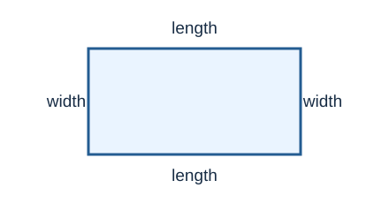

# Lesson 11: Word Problems With Linear Equations
*Fundamental Math / Course 2*

[Lesson 8](./08-one-variable-linear-equations.md) taught how to solve an equation once it is
written. In a word problem, the new work is deciding **what the variable means** and
**which quantities must be equal**. This lesson uses one variable to model costs,
consecutive numbers, shapes, and comparisons.

## 1. A Four-Step Method

1. **Define the variable.** Write what it counts or measures, including units.
2. **Build the equation.** Express each quantity in terms of the variable. Use the
   sentence that says two quantities are equal.
3. **Solve.** Simplify each side, then use the same operation on both sides.
4. **Check and answer.** Substitute into the *story*, not just the equation. State the
   requested quantity with units.

For example, if $x$ is the number of movie tickets, a $\$4$ booking fee plus $\$6$ per
ticket gives a total cost of $4+6x$ dollars. If the bill was $\$34$, the equation is
$4+6x=34$. The unit of $x$ is **tickets**, not dollars.

## 2. Translate Relationships Carefully

| Words | Expression or equation |
| --- | --- |
| $5$ more than a number $x$ | $x+5$ |
| $5$ less than twice $x$ | $2x-5$ |
| triple a number, then add $4$ | $3x+4$ |
| two consecutive whole numbers, first $x$ | $x$ and $x+1$ |
| a length $3$ greater than a width $w$ | $w+3$ |
| two amounts are the same | set their expressions equal |

The order matters: “$5$ less than twice $x$” is $2x-5$, while “twice the number that is
$5$ less than $x$” is $2(x-5)$.

## 3. Worked Example: A Total With a Fixed Fee

**Example (Tickets and a booking fee).** A group pays a $\$4$ booking fee and $\$6$ per
ticket. The total is $\$34$. How many tickets did the group buy?

**Solution:**

Let $x$ be the number of tickets. The fee and tickets together cost $4+6x$ dollars,
so $4+6x=34$. Subtract $4$ from both sides, then divide by $6$:

$$6x=30\quad\Longrightarrow\quad x=5.$$

Check the story: five tickets cost $5\cdot\$6=\$30$; adding the $\$4$ fee gives
$\$34$. The group bought **5 tickets**.

$\square$

## 4. Worked Example: Consecutive Numbers

**Example (Two consecutive integers).** Two consecutive integers add to $35$. Find
both integers.

**Solution:**

Let $x$ be the smaller integer. The next integer is $x+1$, so

$$x+(x+1)=35\quad\Longrightarrow\quad 2x+1=35
\quad\Longrightarrow\quad 2x=34\quad\Longrightarrow\quad x=17.$$

The integers are **17 and 18**. They are consecutive, and $17+18=35$.

$\square$

## 5. Worked Example: Perimeter

**Example (Rectangle dimensions).** A rectangle's length is $3$ cm more than its width.
Its perimeter is $30$ cm. Find both dimensions.

**Solution:**

Let $w$ be the width in centimeters. Then the length is $w+3$ centimeters. The
diagram labels the four sides; opposite sides have equal lengths.

Add all four sides to get the perimeter:

$$w+(w+3)+w+(w+3)=30.$$

Combine like terms and solve:

$$4w+6=30\quad\Longrightarrow\quad 4w=24\quad\Longrightarrow\quad w=6.$$

The length is $6+3=9$ cm. Check: $6+9+6+9=30$ cm. The dimensions are
**6 cm by 9 cm**.

$\square$

## 6. Worked Example: Two Expressions for the Same Amount

**Example (Comparing two rental plans).** Plan A charges $\$5$ plus $\$3$ per hour.
Plan B charges $\$2$ plus $\$4$ per hour. After how many hours do they cost the same?

**Solution:**

Let $h$ be the number of hours. Plan A costs $5+3h$ dollars and Plan B costs
$2+4h$ dollars. At the same cost,

$$5+3h=2+4h.$$

Subtract $3h$ from both sides: $5=2+h$. Subtract $2$: $h=3$.
Check: Plan A costs $5+3(3)=\$14$ and Plan B costs $2+4(3)=\$14$.
They cost the same after **3 hours**.

$\square$

When the variable appears on both sides, subtract one variable term from both sides
first. This keeps the equation balanced.

## 7. Class Practice

For every problem, **define a variable, write an equation, solve it, and check the
answer in the story**. Open the solution after trying the problem.

### Practice 1: Number Language

**Problem (Number language).** Seven less than three times a number is $20$. What is the number?

Solution

**Solution:**

Let $x$ be the number. The equation is $3x-7=20$. Thus $3x=27$ and $x=9$.
Check: $3(9)-7=20$. The number is **9**.

$\square$

### Practice 2: Money

**Problem (Taxi fare).** A taxi ride has a $\$5$ starting fee and costs $\$2$ per mile. The final
bill is $\$23$. How many miles was the ride?

Solution

**Solution:**

Let $m$ be miles. Then $5+2m=23$, so $2m=18$ and $m=9$. Check:
$\$5+9(\$2)=\$23$. The ride was **9 miles**.

$\square$

### Practice 3: Three Consecutive Integers

**Problem (Three consecutive integers).** Three consecutive integers have a sum of $51$. Find them.

Solution

**Solution:**

Let $x$ be the first integer. The others are $x+1$ and $x+2$. Then
$x+(x+1)+(x+2)=51$, so $3x+3=51$, $3x=48$, and $x=16$.
The integers are **16, 17, and 18**; their sum is $51$.

$\square$

### Practice 4: Perimeter

**Problem (Rectangle perimeter).** A rectangle's length is $5$ cm more than its width. Its perimeter is
$42$ cm. Find its length and width.

Solution

**Solution:**

Let $w$ be the width in centimeters. Then the length is $w+5$, and
$2w+2(w+5)=42$. Therefore $4w+10=42$, $4w=32$, and $w=8$.
The length is $13$ cm. Check: $2(8)+2(13)=42$ cm. The dimensions are
**8 cm by 13 cm**.

$\square$

### Practice 5: Equal Costs

**Problem (Equal rental costs).** A bike rental at Shop A costs $\$8$ plus $\$2$ per hour. At Shop B it
costs $\$3$ plus $\$3$ per hour. For how many hours is the cost the same?

Solution

**Solution:**

Let $h$ be hours. Set the costs equal: $8+2h=3+3h$. Subtract $2h$ to get
$8=3+h$, so $h=5$. Check: both plans cost $\$18$ at five hours.
The costs are equal after **5 hours**.

$\square$

### Practice 6: A Fraction of a Number

**Problem (A fraction of a number).** One fourth of a number, plus $7$, equals $12$. What is the number?

Solution

**Solution:**

Let $x$ be the number. Then $\frac{x}{4}+7=12$. Subtract $7$:
$\frac{x}{4}=5$. Multiply both sides by $4$: $x=20$. Check:
$\frac{20}{4}+7=5+7=12$. The number is **20**.

$\square$

## 8. Common Mistakes

- **Reversing “less than.”** “$7$ less than $3x$” means $3x-7$.
- **Using the wrong variable unit.** If $m$ counts miles, $2m$ is a cost in dollars
  when the rate is $\$2$ per mile.
- **Forgetting a repeated side.** A rectangle has two widths and two lengths in its
  perimeter.
- **Stopping at the variable.** If $x$ is the smaller of two consecutive numbers,
  answer with both $x$ and $x+1$ when the question asks for both.
- **Checking only the arithmetic.** A solution should also fit the story: a count of
  tickets cannot be negative or fractional.

## 9. Key Takeaways

- Define the variable with a unit before writing an equation.
- Translate each amount separately; set expressions equal only when the story says
  they represent the same total or value.
- Solve with balanced operations, then check the result in the original story.
- Give the quantity the question asks for, with units.
