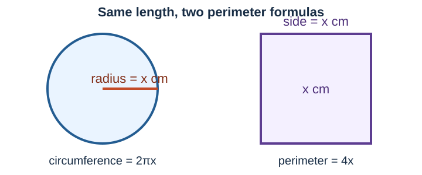

# Lesson 13: Geometry Word Problems With Linear Equations
*Fundamental Math / Course 2*

In [Lesson 11](./11-linear-equation-word-problems.md), a perimeter formula helped us
model a rectangle. This lesson uses formulas as the background of the story: a circle's
circumference and a rectangle's or square's perimeter. The algebra is still a
one-variable linear equation. The main task is to turn each shape description into the
correct expression before solving.

## 1. Formulas Are Translation Tools

| Shape | Quantity | Formula |
| --- | --- | --- |
| Circle | circumference | $C=2\pi r$ |
| Square | perimeter | $P=4s$ |
| Rectangle | perimeter | $P=2l+2w$ |
| Square | area | $A=s^2$ |
| Rectangle | area | $A=lw$ |

In a word problem, a formula might be one side of an equation. For example, if a
circle's radius and a square's side are both $x$ cm, then the circle's circumference is
$2\pi x$ and the square's perimeter is $4x$.

> **Use the stated value of $\pi$.** If a problem says to use $\pi\approx3.14$ or
> $\pi\approx\frac{22}{7}$, use that value consistently. If no approximation is
> requested, leave $\pi$ in an exact expression until the last step.

## 2. A Geometry Modeling Routine

1. **Define the variable** as a length, with units.
2. **Write each geometric expression** from its formula.
3. **Translate the comparison.** “Is $d$ cm greater than” means larger expression
   $=$ smaller expression $+d$.
4. **Solve the linear equation.**
5. **Answer every question asked.** A side length may be needed before finding an area.
6. **Check units and the story.** Perimeter and circumference use cm; area uses
   $\text{cm}^2$.

## 3. Worked Example: Circle and Square

**Example (Same radius and side).** Circle A's radius is the same as Square B's side
length. The circumference of Circle A is $16$ cm greater than the perimeter of Square B.
Use $\pi=\frac{22}{7}$. Find the side length and area of Square B.

**Solution:**

Let $s$ be Square B's side length in centimeters. Circle A's radius is also $s$ cm.
Therefore,

$$\text{circle circumference}=2\pi s=2\left(\frac{22}{7}\right)s=\frac{44}{7}s$$

and

$$\text{square perimeter}=4s.$$

“The circumference is $16$ cm greater” means

$$\frac{44}{7}s=4s+16.$$

Multiply both sides by $7$, then solve:

$$44s=28s+112$$
$$16s=112$$
$$s=7.$$

Square B has side length **$7$ cm**. Its area is

$$A=s^2=7^2=49\text{ cm}^2.$$

Check: Circle A's circumference is $2\left(\frac{22}{7}\right)(7)=44$ cm, and
Square B's perimeter is $4(7)=28$ cm. The difference is $44-28=16$ cm.

$\square$

## 4. Worked Example: A Rectangle With Related Sides

**Example (Garden border).** A rectangular garden has a length that is $5$ m more than
twice its width. Its perimeter is $46$ m. Find the garden's dimensions and area.

**Solution:**

Let $w$ be the width in meters. The length is $2w+5$ m. Use the perimeter formula:

$$2(2w+5)+2w=46.$$

Distribute and solve:

$$4w+10+2w=46$$
$$6w=36$$
$$w=6.$$

The length is $2(6)+5=17$ m. The area is

$$A=lw=17(6)=102\text{ m}^2.$$

Check: $2(17)+2(6)=46$ m. The garden is **$17$ m by $6$ m**, with area
**$102\text{ m}^2$**.

$\square$

## 5. Worked Example: The Given $7$ cm Difference

**Example (Circle A and Square B).** Circle A's radius is the same as Square B's side
length. The circumference of Circle A is $7$ cm greater than the perimeter of Square B.
Use $\pi\approx3.14$. Find Square B's side length and area to the nearest hundredth.

**Solution:**

Let $s$ be the side length of Square B in centimeters. The radius of Circle A is $s$ cm,
so its circumference is $2(3.14)s=6.28s$. The square's perimeter is $4s$. Thus

$$6.28s=4s+7.$$

Subtract $4s$ and divide by $2.28$:

$$2.28s=7$$
$$s\approx3.07.$$

The side length is about **$3.07$ cm**. Now use the unrounded value for the area:

$$A=s^2\approx(3.070175\ldots)^2\approx9.43\text{ cm}^2.$$

Check using the rounded side: the circle circumference is about $6.28(3.07)=19.28$ cm
and the square perimeter is $4(3.07)=12.28$ cm, a difference of about $7$ cm.

$\square$

> **Why is this answer a decimal?** The problem is still linear, but the numbers do not
> happen to give a whole-number side length. A length can be decimal, so do not round it
> to a whole number unless the question asks you to.

## 6. Worked Example: Circle and Rectangle Together

**Example (Fountain and garden).** A rectangular garden is beside a circular fountain.
The garden's width is the same as the fountain's radius, and its length is $5$ m longer
than its width. Using $\pi=3$, the sum of the fountain's circumference and the garden's
perimeter is $50$ m. Find the fountain radius, the garden's dimensions, and the garden's
area.

> **Hint:** Let $r$ be the radius of the circular fountain in meters.

**Solution:**

Let $r$ be the fountain's radius in meters. Its circumference is

$$C=2(3)r=6r.$$

The garden has width $r$ and length $r+5$, so its perimeter is

$$P=2r+2(r+5)=4r+10.$$

The two boundary lengths add to $50$ m:

$$6r+(4r+10)=50.$$

Solve:

$$10r+10=50$$
$$10r=40$$
$$r=4.$$

The garden is $4$ m by $4+5=9$ m. Its area is

$$A=4(9)=36\text{ m}^2.$$

Check: the fountain circumference is $6(4)=24$ m and the garden perimeter is
$2(4)+2(9)=26$ m. Their sum is $24+26=50$ m. The fountain radius is **$4$ m**;
the garden is **$4$ m by $9$ m**, with area **$36\text{ m}^2$**.

$\square$

## 7. Class Practice

For each problem, define a variable, write the equation from the formula, solve, and
check the requested measurement. Open a solution after trying.

### Practice 1: Square Perimeter and Area

**Problem (Patio).** A square patio has perimeter $52$ ft. Find its side length and area.

Solution

**Solution:**

Let $s$ be the side length in feet. Then $4s=52$, so $s=13$. The area is
$13^2=169\text{ ft}^2$. The patio has side length **$13$ ft** and area
**$169\text{ ft}^2$**.

$\square$

### Practice 2: Rectangle Perimeter and Area

**Problem (Picture frame).** A rectangle's length is $4$ cm more than its width. Its
perimeter is $32$ cm. Find its dimensions and area.

Solution

**Solution:**

Let $w$ be the width. Then the length is $w+4$, so
$2w+2(w+4)=32$. Thus $4w+8=32$, $w=6$, and the length is $10$ cm. Its area is
$6(10)=60\text{ cm}^2$. The dimensions are **$6$ cm by $10$ cm**, and the area is
**$60\text{ cm}^2$**.

$\square$

### Practice 3: Circle and Square

**Problem (Matching lengths).** A circle's radius equals a square's side length. Using
$\pi=\frac{22}{7}$, the circle's circumference is $8$ cm greater than the square's
perimeter. Find the square's side length and area.

Solution

**Solution:**

Let $s$ be the square's side length. Then $\frac{44}{7}s=4s+8$. Multiplying by $7$
gives $44s=28s+56$, so $16s=56$ and $s=3.5$. The area is
$(3.5)^2=12.25\text{ cm}^2$. The side length is **$3.5$ cm** and the area is
**$12.25\text{ cm}^2$**.

$\square$

### Practice 4: Circle From a Perimeter Comparison

**Problem (Circular track).** A square has a side length that is $1$ m longer than the
radius of a circular track. Using $\pi=3$, the track's circumference is equal to the
square's perimeter. Find the track's radius and the square's area.

> **Hint:** Let $r$ be the radius of the circular track in meters.

Solution

**Solution:**

The circle circumference is $2(3)r=6r$, and the square perimeter is $4(r+1)$. Set them
equal: $6r=4(r+1)$. Thus $6r=4r+4$, so $2r=4$ and $r=2$ m. The square side is $3$ m,
so its area is $3^2=9\text{ m}^2$. The radius is **$2$ m** and the square's area is
**$9\text{ m}^2$**.

$\square$

### Practice 5: Rectangle With a Known Area Question

**Problem (Banner).** The length of a rectangular banner is three times its width. Its
perimeter is $64$ in. Find the dimensions and area.

Solution

**Solution:**

Let $w$ be the width. The length is $3w$, so $2(3w)+2w=64$. Therefore $8w=64$ and
$w=8$ in. The length is $24$ in, and the area is $24(8)=192\text{ in}^2$. The banner is
**$24$ in by $8$ in**, with area **$192\text{ in}^2$**.

$\square$

### Practice 6: Combined Circle and Rectangle Boundaries

**Problem (Pool and deck).** A rectangular deck surrounds a circular pool. The deck's
width is the same as the pool's radius, and its length is $3$ m more than twice its
width. Using $\pi=3$, the pool circumference and deck perimeter have a combined length
of $72$ m. Find the pool's radius, the deck's dimensions, and the deck's area.

> **Hint:** Let $r$ be the radius of the circular pool in meters.

Solution

**Solution:**

The pool circumference is $6r$. The deck perimeter is
$2r+2(2r+3)=6r+6$. Their sum gives

$$6r+(6r+6)=72.$$

Thus $12r+6=72$, so $12r=66$ and $r=5.5$ m. The deck width is $5.5$ m and its
length is $2(5.5)+3=14$ m. Its area is

$$5.5(14)=77\text{ m}^2.$$

The radius is **$5.5$ m**; the deck is **$5.5$ m by $14$ m**, with area
**$77\text{ m}^2$**.

$\square$

### Practice 7: Twice a Circumference, Plus a Fixed Length

**Problem (Track and field).** A rectangular field is next to a circular track. The
field's width is three times the track's radius, and its length is $3$ m more than four
times the track's radius. Using $\pi=3$, the field's perimeter is $12$ m more than twice
the track's circumference. Find the track's radius and the field's area.

> **Hint:** Let $r$ be the radius of the circular track in meters.

Solution

**Solution:**

The track circumference is $6r$. The field perimeter is

$$2(3r)+2(4r+3)=14r+6.$$

“$12$ m more than twice” gives

$$14r+6=2(6r)+12.$$

So $14r+6=12r+12$, $2r=6$, and $r=3$ m. The field is $3(3)=9$ m wide and
$4(3)+3=15$ m long. Its area is

$$9(15)=135\text{ m}^2.$$

Check: the track circumference is $18$ m. Twice that is $36$ m, and $36+12=48$ m;
the field perimeter is $2(9)+2(15)=48$ m. The radius is **$3$ m** and the field's area
is **$135\text{ m}^2$**.

$\square$

## 8. Common Mistakes

- **Using diameter in place of radius.** In $C=2\pi r$, $r$ is the radius. If a diameter
  is given, first use $r=\frac{d}{2}$.
- **Writing $2\pi s$ for a square.** A square has no circumference; its perimeter is
  $4s$.
- **Leaving out two rectangle sides.** Rectangle perimeter is $2l+2w$, not $l+w$.
- **Mixing length and area units.** A perimeter difference is measured in cm; an area is
  measured in $\text{cm}^2$.
- **Rounding too early.** Keep calculator digits until the final requested answer,
  especially before squaring a length to find area.

## 9. Key Takeaways

- A formula converts a geometric description into an algebraic expression.
- When two measurements are compared, write both formula expressions before solving.
- A combined boundary problem adds the circumference expression and perimeter expression
  before setting their sum equal to the stated total.
- Circumference and perimeter are linear in a length; area is usually calculated after
  the length is known.
