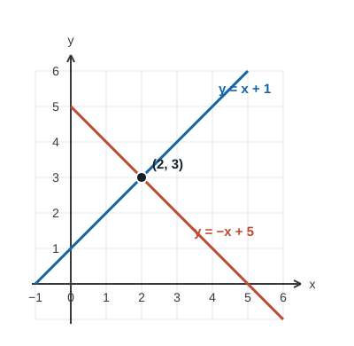

# Lesson 14: Intersections of Two Lines on the $xy$-Plane
*Fundamental Math / Course 3*

Lesson 10 solved pairs of linear equations by substitution and elimination. Lesson 12
showed that each linear equation draws a line on the coordinate plane. Now we connect
those ideas: solving two line equations together means finding the point that lies on
**both** lines.

## 1. What Does an Intersection Mean?

**Definition (Intersection point).** An intersection point of two graphs is a point they
share. If the graphs represent equations, its coordinates satisfy both equations.

For example, consider

$$\begin{cases}y=x+1,\\y=-x+5.\end{cases}$$

The lines meet at $(2,3)$: $3=2+1$ and $3=-2+5$. The ordered pair $(2,3)$ is the
**solution of the system**. A point on only one line is not a solution of the system.

When reading a graph, name the intersection as an **ordered pair** $(x,y)$. The graph is
useful for seeing where the lines meet; algebra gives the exact coordinates, especially
when the crossing falls between grid marks.

## 2. Find the Intersection by Graphing

To graph a pair of lines:

1. Draw both lines on the same coordinate plane. For each line, plot two correct points;
   use its slope or a third point to check the drawing.
2. Read the coordinates of the crossing, if there is one.
3. Substitute those coordinates into **both** original equations to verify them.

**Example (A crossing at a grid point).** Find the intersection of $y=x+1$ and
$y=-x+5$ from the graph above.

**Solution:**

The first line passes through $(0,1)$ and $(2,3)$. The second passes through $(0,5)$
and $(2,3)$. Both lines contain $(2,3)$, so the intersection is $\boxed{(2,3)}$.
Substitution into both equations confirms the point.

$\square$

**Example (When a graph gives only an estimate).** Estimate the intersection of
$y=2x+1$ and $y=-x+2$, then find its exact coordinates.

**Solution:**

A sketch places the crossing near $(0.3,1.7)$. At the intersection, the two expressions
for $y$ are equal:

$$2x+1=-x+2\quad\Longrightarrow\quad 3x=1\quad\Longrightarrow\quad x=\frac13.$$

Then $y=2(\frac13)+1=\frac53$. The exact intersection is
$\boxed{\left(\frac13,\frac53\right)}$. Check the other line:
$-\frac13+2=\frac53$.

$\square$

## 3. Find the Intersection by Equating the $y$-Values

When both equations have the form $y=mx+b$, the same intersection has the same $y$-value
on both lines. Set the two right sides equal, solve for $x$, and substitute that $x$ into
either line to get $y$.

For $y=m_1x+b_1$ and $y=m_2x+b_2$:

$$m_1x+b_1=m_2x+b_2.$$

If $m_1\ne m_2$, the lines have different slopes and meet exactly once. Rearranging gives

$$x=\frac{b_2-b_1}{m_1-m_2}.$$

The formula is a shortcut, but solving the equation directly usually makes the signs
easier to track. Always find the corresponding $y$ afterward; an $x$-value alone is not
the intersection point.

**Example (An exact intersection).** Find where $y=3x-4$ meets $y=-x+8$.

**Solution:**

Equate the expressions for $y$:

$$3x-4=-x+8\quad\Longrightarrow\quad 4x=12\quad\Longrightarrow\quad x=3.$$

Substitute into the first line: $y=3(3)-4=5$. The intersection is
$\boxed{(3,5)}$. Check the second line: $-3+8=5$.

$\square$

## 4. Standard Form, Vertical Lines, and Horizontal Lines

The lines need not both start in slope-intercept form. Rearrange an equation if that
helps, or use substitution or elimination from Lesson 10.

**Example (Two equations in standard form).** Find the intersection of
$2x+y=7$ and $x-y=2$.

**Solution:**

Add the equations to eliminate $y$:

$$\begin{aligned}(2x+y)+(x-y)&=7+2,\\3x&=9.\end{aligned}$$

Thus $x=3$. From $x-y=2$, we get $3-y=2$, so $y=1$. The intersection is
$\boxed{(3,1)}$. In the original equations, $2(3)+1=7$ and $3-1=2$.

$\square$

A vertical line has equation $x=c$; every point on it already has $x=c$. A horizontal
line has equation $y=d$; every point on it already has $y=d$. Use that known coordinate
instead of trying to write a vertical line as $y=mx+b$.

**Example (A vertical line).** Where do $x=2$ and $y=-3x+7$ meet?

**Solution:**

Substitute $x=2$ into the second equation: $y=-3(2)+7=1$. The intersection is
$\boxed{(2,1)}$.

$\square$

**Example (Two coordinate lines).** Where do $x=-4$ and $y=3$ meet?

**Solution:**

The first line fixes the $x$-coordinate at $-4$; the second fixes the $y$-coordinate at
$3$. They meet at $\boxed{(-4,3)}$.

$\square$

## 5. How Many Intersections Can Two Lines Have?

Two complete lines on the plane have **one**, **zero**, or **infinitely many** common
points. They cannot meet at exactly two points: two distinct points determine one line.

| Relationship | Graph | System's solutions |
| --- | --- | --- |
| Different slopes | Lines cross once | One ordered pair |
| Same slope, different intercepts | Distinct parallel lines | No solution |
| Same line written in different ways | Lines overlap | Infinitely many ordered pairs |

The slope comparison in the table applies to nonvertical lines written as $y=mx+b$.
Two distinct vertical lines $x=c$ and $x=d$ are parallel; the same vertical line written
twice overlaps itself. A vertical line and a nonvertical line always meet once.

**Example (Parallel lines).** Find the intersection of $y=2x+1$ and $y=2x-3$.

**Solution:**

Equating $y$-values gives $2x+1=2x-3$. Subtracting $2x$ yields $1=-3$, which is
impossible. The lines have equal slope $2$ but different $y$-intercepts, so they never
meet. The system has $\boxed{\text{no solution}}$.

$\square$

**Example (The same line twice).** Find the intersections of $y=-2x+4$ and
$2x+y=4$.

**Solution:**

Rearrange the second equation to $y=-2x+4$. Both equations describe the same line, so
**every** point on it satisfies both equations. The system has
$\boxed{\text{infinitely many solutions}}$, such as $(0,4)$ and $(2,0)$.

$\square$

An algebraic contradiction such as $1=-3$ signals parallel distinct lines. An identity
such as $4=4$ signals overlapping lines. In the identity case, give the shared line's
equation to describe all the solutions; the identity does not mean that every point in
the plane is a solution.

## 6. Intersections in a Real Situation

An intersection can represent the moment when two changing quantities have the same
value. Decide whether the mathematical answer makes sense in the situation's domain.

**Example (Comparing two plans).** Plan A costs $\$8$ plus $\$3$ per ride. Plan B costs
$\$20$ plus $\$1$ per ride. After how many rides do they cost the same, and what is that
cost?

**Solution:**

Let $x$ be the number of rides and $y$ the cost in dollars. The lines are
$y=3x+8$ and $y=x+20$. Set the costs equal:

$$3x+8=x+20\quad\Longrightarrow\quad 2x=12\quad\Longrightarrow\quad x=6.$$

At $x=6$, both plans cost $y=3(6)+8=26$ dollars. Their graphs intersect at
$\boxed{(6,26)}$: **6 rides, $\$26$**. Because rides must be whole numbers and $6$ is
nonnegative, the answer is meaningful here.

$\square$

## 7. Class Practice

Try each problem before opening its solution. Sketch both lines for Problems 1 and 4.

**Problem 1.** Graph $y=x-2$ and $y=-2x+4$ on the same axes. Find their intersection
and check it in both equations.

Solution

The first line passes through $(0,-2)$ and $(2,0)$. The second passes through $(0,4)$
and $(2,0)$, so they meet at $\boxed{(2,0)}$. Checks: $0=2-2$ and $0=-2(2)+4$.

$\square$

**Problem 2.** Find the exact intersection of $y=\frac12x+3$ and $y=-x$.

Solution

Set $\frac12x+3=-x$. Then $\frac32x=-3$, so $x=-2$. Substitution gives $y=2$.
The point is $\boxed{(-2,2)}$; both equations give $y=2$ there.

$\square$

**Problem 3.** Find where $3x+2y=12$ meets $x=2$.

Solution

Substitute $x=2$: $3(2)+2y=12$, so $2y=6$ and $y=3$. The point is
$\boxed{(2,3)}$.

$\square$

**Problem 4.** How many intersections do $y=-x+4$ and $2x+2y=8$ have? Describe all
solutions.

Solution

Dividing the second equation by $2$ gives $x+y=4$, or $y=-x+4$. The lines overlap, so
there are $\boxed{\text{infinitely many intersections}}$: all points $(x,4-x)$, where
$x$ is any real number.

$\square$

**Problem 5.** How many intersections do $4x-2y=6$ and $y=2x+1$ have?

Solution

The first equation becomes $y=2x-3$. Both lines have slope $2$, but their
$y$-intercepts are $-3$ and $1$. They are parallel, so there are
$\boxed{\text{no intersections}}$.

$\square$

**Problem 6.** Two quantities follow $y=5x+2$ and $y=3x+10$. Find the value of $x$
when they are equal and the common value of $y$.

Solution

Set $5x+2=3x+10$. Then $2x=8$, so $x=4$. Both quantities equal $22$, giving the
intersection $\boxed{(4,22)}$.

$\square$

**Problem 7.** Line $L$ passes through $(-1,1)$ and $(3,9)$. Find an equation for
$L$, then find where it intersects the line $y=-x+6$.

Solution

The slope of $L$ is $m=\frac{9-1}{3-(-1)}=\frac84=2$. Using $(-1,1)$ in
$y=mx+b$ gives $1=2(-1)+b$, so $b=3$ and $L$ has equation $y=2x+3$.

At the intersection, $2x+3=-x+6$, so $3x=3$ and $x=1$. Then $y=2(1)+3=5$.
The intersection is $\boxed{(1,5)}$. Check: $5=-1+6$ on the other line.

$\square$

**Problem 8.** Line $M$ has slope $-\frac12$ and passes through $(2,4)$.
Write its equation in slope-intercept form, then find its intersection with $y=x+1$.

Solution

Write $M$ as $y=-\frac12x+b$. Substituting $(2,4)$ gives
$4=-\frac12(2)+b=-1+b$, so $b=5$ and $M$ is $y=-\frac12x+5$.

Set $-\frac12x+5=x+1$. Then $4=\frac32x$, so $x=\frac83$. The other line gives
$y=\frac83+1=\frac{11}{3}$. The intersection is
$\boxed{\left(\frac83,\frac{11}{3}\right)}$. Check on $M$:
$-\frac12\left(\frac83\right)+5=-\frac43+5=\frac{11}{3}$.

$\square$

## 8. Common Mistakes and Key Takeaways

- A point on one line alone is not an intersection. Check it in both equations.
- An intersection is an ordered pair. After finding $x$, calculate $y$.
- A graph may suggest a decimal approximation; solve algebraically when exact
  coordinates are needed.
- Same slope means **no intersection** only if the lines are distinct. Equivalent
  equations describe one overlapping line and infinitely many solutions.
- For $x=c$, substitute $c$ directly. Vertical lines do not have slope-intercept form.
- If a line is given by points or by a slope and a point, write its equation before
  setting the two lines' $y$-values equal.
