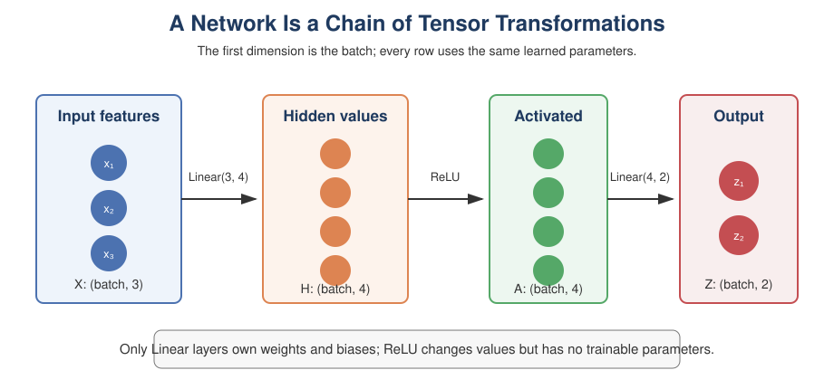

# Lesson 2: Build a Network with Modules and Activations
*ML / D07-Torch-NN-Intro*

A neural network is a module containing smaller modules. Linear layers provide
learned transformations, while activation functions let the complete network
represent nonlinear relationships.



## 1. Why Stacking Linear Layers Is Not Enough

Suppose two layers have no activation between them:

$$
h=W_1x+b_1,
$$

$$
z=W_2h+b_2.
$$

Substitution gives

$$
z=W_2W_1x+(W_2b_1+b_2).
$$

If we define $W'=W_2W_1$ and $b'=W_2b_1+b_2$, then

$$
z=W'x+b'.
$$

The two linear layers collapse into one linear transformation. Depth becomes
useful when nonlinear activations appear between the layers.

## 2. ReLU Adds Nonlinearity

The rectified linear unit is

$$
\operatorname{ReLU}(z)=\max(0,z).
$$

It operates element by element. Positive values remain unchanged and negative
values become zero.

```python
import torch
from torch import nn

relu = nn.ReLU()
values = torch.tensor([-2.0, 0.0, 3.0])
print(relu(values))  # tensor([0., 0., 3.])
```

ReLU has no trainable parameters. It changes the computation performed by the
network without adding weights or biases.

## 3. The Fast Path: `nn.Sequential`

Use `nn.Sequential` when data simply passes through modules in order.

```python
model = nn.Sequential(
    nn.Linear(3, 8),
    nn.ReLU(),
    nn.Linear(8, 4),
    nn.ReLU(),
    nn.Linear(4, 1),
)

X = torch.randn(16, 3)
output = model(X)

print(model)
print(output.shape)  # torch.Size([16, 1])
```

The layer sizes must form a chain:

```text
(16, 3) -> (16, 8) -> (16, 8) -> (16, 4) -> (16, 4) -> (16, 1)
```

The first dimension remains the batch size.

## 4. The Flexible Path: Subclass `nn.Module`

Use a custom module when the forward computation needs named stages, branches,
multiple inputs, or other logic.

```python
class SmallNetwork(nn.Module):
    def __init__(self, n_features, n_hidden, n_outputs):
        super().__init__()
        self.hidden = nn.Linear(n_features, n_hidden)
        self.activation = nn.ReLU()
        self.output = nn.Linear(n_hidden, n_outputs)

    def forward(self, X):
        hidden_values = self.hidden(X)
        activated_values = self.activation(hidden_values)
        return self.output(activated_values)


model = SmallNetwork(n_features=3, n_hidden=8, n_outputs=1)
predictions = model(torch.randn(16, 3))
print(predictions.shape)  # torch.Size([16, 1])
```

Two methods have distinct jobs:

- `__init__` creates and registers modules that own parameters;
- `forward` describes how tensors move through those modules.

Always call `super().__init__()` before assigning child modules.

## 5. Register Layers in `__init__`

Do not create trainable layers inside `forward`:

```python
class BrokenNetwork(nn.Module):
    def forward(self, X):
        layer = nn.Linear(X.shape[1], 1)  # new random parameters every call
        return layer(X)
```

This model creates a fresh layer every time it receives data. The optimizer
cannot reliably track those parameters, and the model never preserves what it
learned. Create persistent layers in `__init__`.

## 6. Inspect a Network Before Training

```python
model = SmallNetwork(3, 8, 1)

for name, parameter in model.named_parameters():
    print(f"{name:20s} {tuple(parameter.shape)}")

total_parameters = sum(p.numel() for p in model.parameters())
trainable_parameters = sum(
    p.numel() for p in model.parameters() if p.requires_grad
)

print(total_parameters)
print(trainable_parameters)
```

For this network:

$$
(3\cdot8+8)+(8\cdot1+1)=41.
$$

Before training, also send one small batch through the model:

```python
X_small = torch.randn(5, 3)
output = model(X_small)
assert output.shape == (5, 1)
assert torch.isfinite(output).all()
```

This catches architecture mistakes before they become training-loop mistakes.

## 7. Hidden Width and Output Width Mean Different Things

Hidden width is a design choice controlling the model's capacity. Output width
is determined by the task:

| Task | Typical final layer |
|---|---|
| Predict one continuous value | `nn.Linear(hidden, 1)` |
| Predict one binary logit | `nn.Linear(hidden, 1)` |
| Predict one of $K$ classes | `nn.Linear(hidden, K)` |
| Predict $r$ continuous values | `nn.Linear(hidden, r)` |

The final layer is usually left without an activation during training. The loss
function may combine the appropriate activation with a numerically stable loss,
as we will see in Lesson 3.

## 8. Class Practice 1: Trace the Shapes

Trace the shape after every module:

```python
model = nn.Sequential(
    nn.Linear(5, 12),
    nn.ReLU(),
    nn.Linear(12, 7),
    nn.ReLU(),
    nn.Linear(7, 3),
)

X = torch.randn(40, 5)
```

<details>
<summary>Solution</summary>

The shapes are

```text
(40, 5) -> (40, 12) -> (40, 12) -> (40, 7) -> (40, 7) -> (40, 3)
```

ReLU does not change shape.

$\square$

</details>

## 9. Class Practice 2: Count the Parameters

How many trainable scalar parameters are in the model from Practice 1?

<details>
<summary>Solution</summary>

The three linear layers contain

$$
\begin{aligned}
(5\cdot12+12)&=72,\\
(12\cdot7+7)&=91,\\
(7\cdot3+3)&=24.
\end{aligned}
$$

The total is $72+91+24=187$. ReLU contributes no parameters.

$\square$

</details>

## 10. Key Takeaways

- A network is an `nn.Module` containing other modules.
- `nn.Sequential` is ideal for a simple one-direction chain.
- A custom `nn.Module` separates layer construction from the forward computation.
- Activations prevent stacked linear layers from collapsing into one linear map.
- Register trainable layers in `__init__`, not inside `forward`.
- Test shapes with a small batch before training.

Next, we will connect each task to the correct output, target, and loss-function
contract.

