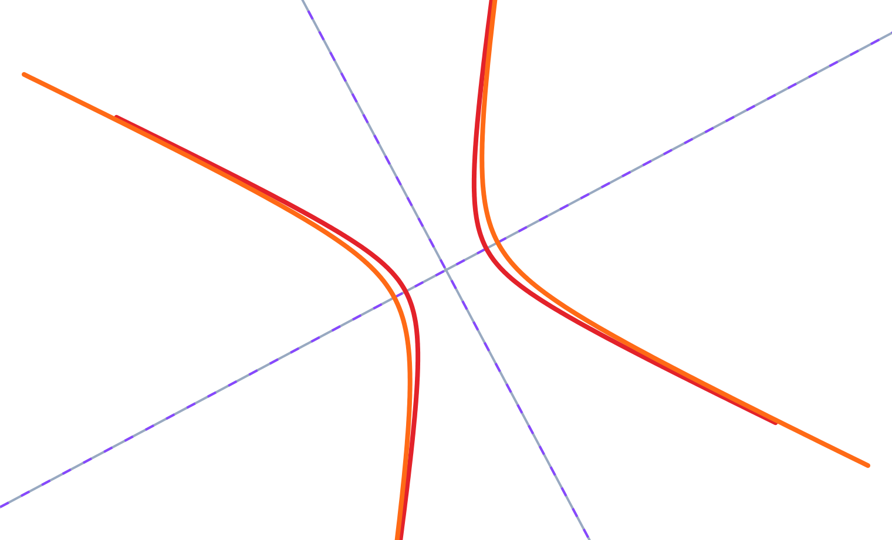

# Real Symmetric Matrices, Quadratic Forms, and Positive Definiteness
*ML / M02 — Linear Algebra*

Quadratic forms turn a vector into a number using a matrix. They describe
curvature, squared distance, energy, and the local shape of many optimization
objectives. For real symmetric matrices, eigenvalues give a complete and clean
test for whether that shape is bowl-like, flat in some direction, or saddle-like.

## Learning Goals

By the end of this lesson, you should be able to:

- write and evaluate a quadratic form $x^TAx$;
- reduce a symmetric quadratic form to a sum of squares using orthogonal
  diagonalization;
- classify a symmetric matrix as positive definite, semidefinite, indefinite,
  or negative definite; and
- apply positive definiteness tests in two variables and optimization; and
- interpret the condition number of a positive-definite quadratic form.

## Quadratic Forms

Given a real symmetric $n\times n$ matrix $A$, the function

$$
q(x)=x^TAx
$$

is a **quadratic form**. For

$$
A=\begin{pmatrix}a&b\\b&c\end{pmatrix},
\qquad x=\begin{pmatrix}x_1\\x_2\end{pmatrix},
$$

we get

$$
q(x)=ax_1^2+2bx_1x_2+cx_2^2.
$$

Only the symmetric part of a matrix affects $x^TAx$, since

$$
x^TAx=x^T\left(\frac{A+A^T}{2}\right)x.
$$

So studying quadratic forms naturally leads to symmetric matrices.

## Principal Axes: A Sum of Squares

By the spectral theorem, write a real symmetric matrix as

$$
A=Q\Lambda Q^T.
$$

Use the rotated coordinates $y=Q^Tx$. Then

$$
q(x)=x^TQ\Lambda Q^Tx=y^T\Lambda y
=\lambda_1y_1^2+\cdots+\lambda_ny_n^2.
$$

Orthogonal diagonalization therefore removes cross terms by rotating to the
eigenvector axes. The eigenvalues determine the shape.

  
  

## Positive Definiteness

A real symmetric matrix $A$ is:

- **positive definite (PD)** if $x^TAx>0$ for every $x\ne0$;
- **positive semidefinite (PSD)** if $x^TAx\ge0$ for every $x$;
- **negative definite (ND)** if $x^TAx<0$ for every $x\ne0$; and
- **indefinite** if $x^TAx$ is positive for some nonzero vectors and negative
  for others.

### Theorem: Equivalent Tests for Positive (Semi)definiteness

Let $A$ be a real symmetric matrix. A **principal minor** is the determinant
of a submatrix formed by selecting the same set of rows and columns. A
**leading principal minor** uses the first $k$ rows and first $k$ columns for
some $k$.

The following statements are equivalent:

- $A$ is **positive definite**:
  1. $x^TAx>0$ for every $x\ne0$ (the definition);
  2. every eigenvalue of $A$ is positive;
  3. every principal minor of $A$ is positive;
  4. every leading principal minor of $A$ is positive.

- $A$ is **positive semidefinite**:
  1. $x^TAx\ge0$ for every $x$ (the definition);
  2. every eigenvalue of $A$ is nonnegative;
  3. every principal minor of $A$ is nonnegative.

The final PD criterion is **Sylvester's criterion**. There is no analogous
leading-principal-minor test for PSD matrices: nonnegative leading principal
minors alone do not guarantee PSD. For example,

$$
\begin{pmatrix}0&0\\0&-1\end{pmatrix}
$$

has nonnegative leading principal minors ($0$ and $0$), but it has a negative
eigenvalue and is not PSD.

### Proof of the Tests (apart from Sylvester's Criterion)

We prove the positive-definite tests. The positive-semidefinite version is
identical after replacing “positive” by “nonnegative.” The
leading-principal-minor characterization is Sylvester's criterion, which we
state without proof.

**1. Positive definite $\Rightarrow$ all eigenvalues are positive.** Suppose,
for a contradiction, that $A$ has an eigenvalue $\lambda\le0$, with
nonzero eigenvector $v$. Then

$$
v^TAv=v^T(\lambda v)=\lambda\lVert v\rVert^2\le0,
$$

contradicting positive definiteness. Thus every eigenvalue is positive.

**2. All eigenvalues positive $\Rightarrow$ positive definite.** Orthogonally
diagonalize $A$:

$$
A=Q\Lambda Q^T,
\qquad
\Lambda=\operatorname{diag}(\lambda_1,\ldots,\lambda_n).
$$

Let $y=Q^Tx$. This is only a change of coordinates: because $Q$ is
orthogonal, $x\ne0$ exactly when $y\ne0$. Therefore

$$
x^TAx=y^T\Lambda y
=\lambda_1y_1^2+\cdots+\lambda_ny_n^2>0
$$

for every nonzero $x$, since each $\lambda_i>0$.

**3. Positive definite $\Rightarrow$ all principal minors are positive.**
Let $B$ be any principal submatrix of $A$. Given a nonzero vector $z$
of the appropriate size, place its entries in the corresponding coordinates
of $x$ and put zeros elsewhere. Then $x\ne0$ and

$$
z^TBz=x^TAx>0.
$$

So $B$ is positive definite. By the first result, all eigenvalues of $B$
are positive, and hence

$$
\det(B)=\prod_i\lambda_i(B)>0.
$$

Thus every principal minor of $A$ is positive.

**4. All principal minors positive $\Rightarrow$ all eigenvalues are
positive.** Let $M_j$ be the sum of all $j\times j$ principal minors of
$A$. Since every principal minor is positive, $M_j>0$ for every $j$.
The characteristic polynomial is

$$
\det(kI-A)=k^n-M_1k^{n-1}+M_2k^{n-2}-\cdots+(-1)^nM_n.
$$

For $k<0$, every term on the right has sign $(-1)^n$, so their sum cannot
be zero. Hence $A$ has no negative eigenvalues. Also,
$\det(A)=M_n>0$, so zero is not an eigenvalue. Every eigenvalue is
therefore positive.

For the PSD statement, make the same replacements throughout: use
$\lambda\ge0$, nonnegative quadratic forms, and nonnegative principal
minors. In the final step, the same sign argument rules out negative
eigenvalues; zero eigenvalues are allowed.

For $2\times2$ symmetric $A=\begin{pmatrix}a&b\\b&c\end{pmatrix}$,

$$
\boxed{A\text{ is PD}\iff a>0\text{ and }\det(A)=ac-b^2>0.}
$$

### Example

Let

$$
A=\begin{pmatrix}3&1\\1&2\end{pmatrix}.
$$

Here $a=3>0$ and $\det(A)=6-1=5>0$, so $A$ is positive definite. Therefore
$q(x)=3x_1^2+2x_1x_2+2x_2^2$ is strictly positive except at the origin.

## Conditioning and Curvature

For a symmetric positive-definite matrix, let $\lambda_{\max}$ and
$\lambda_{\min}$ be its largest and smallest eigenvalues. Its

$$
\boxed{\kappa(A)=\frac{\lambda_{\max}}{\lambda_{\min}}}
$$

is called its **condition number**—more precisely, its spectral (or
2-norm) condition number. In machine learning and optimization, it measures
how uneven the curvature of the quadratic form is. A large $\kappa(A)$ means
the level-set ellipses are very stretched: the objective is **ill-conditioned**
and gradient descent can make slow progress by zig-zagging across the narrow
direction. A value near $1$ means the curvature is nearly the same in every
direction.

For a positive-semidefinite matrix with $\lambda_{\min}=0$, this ratio is
infinite (or undefined); the quadratic form is flat in at least one direction.

## Why Optimization Cares

For a twice-differentiable function, a positive-definite Hessian at a critical
point signals a strict local minimum; a negative-definite Hessian signals a
strict local maximum; and an indefinite Hessian signals a saddle point. This
connects the geometry of quadratic forms to gradient-based machine learning.

## Class Practice: Ellipses, Hyperbolas, and Principal Axes

For a level set $x^TAx=c$ with $c>0$, diagonalize the symmetric matrix
$A=Q\Lambda Q^T$. In eigenvector coordinates $y=Q^Tx$, the equation becomes
$\lambda_1y_1^2+\lambda_2y_2^2=c$. If both eigenvalues are positive, the
curve is an ellipse; its principal directions are the eigenvectors and the
semiaxis for $\lambda_i$ has length $\sqrt{c/\lambda_i}$. If the eigenvalues
have opposite signs, the curve is a hyperbola; the positive eigenvalue gives
the transverse direction and the negative eigenvalue the conjugate direction.

Work in pairs. For each equation, classify the curve and find its principal
axis directions and semiaxis lengths. Axis directions are lines, so either
sign of a unit eigenvector is acceptable.

### Practice A: Identify the conic

1. $\frac{18}{5}x_1^2+\frac{8}{5}x_1x_2+\frac{12}{5}x_2^2=8$
2. $\frac{11}{5}x_1^2+\frac{16}{5}x_1x_2-\frac{1}{5}x_2^2=8$

For each equation, find the eigenvalues of its quadratic-form matrix and use
their signs to classify the conic. Then find its principal directions and
semiaxis lengths.

### Practice B: Find the axes

Consider $\frac75x_1^2-\frac85x_1x_2+\frac{13}{5}x_2^2=6$.

1. Write its symmetric matrix.
2. Find its eigenvalues and unit eigenvectors.
3. Classify the curve and give the direction and length of each principal
   semiaxis.

### Answers

In each solution, the columns of $P$ are orthonormal eigenvectors of $A$,
so $A=PDP^T$. To find an axis as a line in the original coordinates, set
the *other* new coordinate equal to zero. For example, the $y_1$ axis is
$y_2=0$.

**Practice A(1).**

**Solution:**

$$
A=\frac15\begin{pmatrix}18&4\\4&12\end{pmatrix}
$$

has eigenvalues $4$ and $2$, with unit eigenvectors
$u_1=\frac1{\sqrt5}(2,1)^T$ and $u_2=\frac1{\sqrt5}(-1,2)^T$,
respectively. Thus

$$
P=\frac1{\sqrt5}\begin{pmatrix}2&-1\\1&2\end{pmatrix},\qquad
D=\begin{pmatrix}4&0\\0&2\end{pmatrix},\qquad A=PDP^T.
$$

Set $y=P^Tx$. Explicitly,

$$
y_1=\frac{2x_1+x_2}{\sqrt5},\qquad
y_2=\frac{-x_1+2x_2}{\sqrt5}.
$$

Now the given equation is

$$
x^TAx=x^TPDP^Tx=y^TDy=4y_1^2+2y_2^2=8.
$$

Divide by $8$ to obtain standard ellipse form:

$$
\frac{y_1^2}{2}+\frac{y_2^2}{4}=1.
$$

The **major axis** has direction $u_2$ and line $y_1=0$, equivalently
$2x_1+x_2=0$; its semiaxis length is $2$. The **minor axis** has direction
$u_1$ and line $y_2=0$, equivalently $-x_1+2x_2=0$; its semiaxis length is
$\sqrt2$.

$\square$

**Practice A(2).**

**Solution:**

$$
A=\frac15\begin{pmatrix}11&8\\8&-1\end{pmatrix}
$$

has eigenvalues $3$ and $-1$, with unit eigenvectors
$u_1=\frac1{\sqrt5}(2,1)^T$ and $u_2=\frac1{\sqrt5}(-1,2)^T$,
respectively. Hence

$$
P=\frac1{\sqrt5}\begin{pmatrix}2&-1\\1&2\end{pmatrix},\qquad
D=\begin{pmatrix}3&0\\0&-1\end{pmatrix},\qquad A=PDP^T.
$$

Set $y=P^Tx$, so

$$
y_1=\frac{2x_1+x_2}{\sqrt5},\qquad
y_2=\frac{-x_1+2x_2}{\sqrt5}.
$$

The given equation becomes

$$
x^TAx=x^TPDP^Tx=y^TDy=3y_1^2-y_2^2=8.
$$

Divide by $8$ to obtain standard hyperbola form:

$$
\frac{y_1^2}{8/3}-\frac{y_2^2}{8}=1.
$$

The **transverse axis** has direction $u_1$ and line $y_2=0$,
equivalently $-x_1+2x_2=0$; its semiaxis length is $\sqrt{8/3}$. The
**conjugate axis** has direction $u_2$ and line $y_1=0$, equivalently
$2x_1+x_2=0$; its semiaxis length is $\sqrt8$.

$\square$

**Practice B.**

**Solution:**

$$
A=\frac15\begin{pmatrix}7&-4\\-4&13\end{pmatrix}
$$

has eigenvalue $1$ along $u_1=\frac1{\sqrt5}(2,1)^T$ and eigenvalue $3$
along $u_2=\frac1{\sqrt5}(-1,2)^T$. Set

$$
P=\frac1{\sqrt5}\begin{pmatrix}2&-1\\1&2\end{pmatrix},\qquad
D=\begin{pmatrix}1&0\\0&3\end{pmatrix},\qquad A=PDP^T.
$$

Set $y=P^Tx$, so

$$
y_1=\frac{2x_1+x_2}{\sqrt5},\qquad
y_2=\frac{-x_1+2x_2}{\sqrt5}.
$$

The given equation becomes

$$
x^TAx=x^TPDP^Tx=y^TDy=y_1^2+3y_2^2=6.
$$

Divide by $6$ to obtain standard ellipse form:

$$
\frac{y_1^2}{6}+\frac{y_2^2}{2}=1.
$$

The **major axis** has direction $u_1$ and line $y_2=0$, equivalently
$-x_1+2x_2=0$; its semiaxis length is $\sqrt6$. The **minor axis** has
direction $u_2$ and line $y_1=0$, equivalently $2x_1+x_2=0$; its
semiaxis length is $\sqrt2$.

$\square$

## Quick Check

1. If a symmetric matrix has eigenvalues $2$, $0$, and $5$, how is it classified?
2. What does a negative eigenvalue imply about $x^TAx$?
3. Is $\begin{pmatrix}1&2\\2&1\end{pmatrix}$ positive definite?

### Answers

1. Positive semidefinite.
2. Along its eigenvector direction, the quadratic form is negative.
3. No. Its determinant is $1-4=-3$, so it is indefinite.
