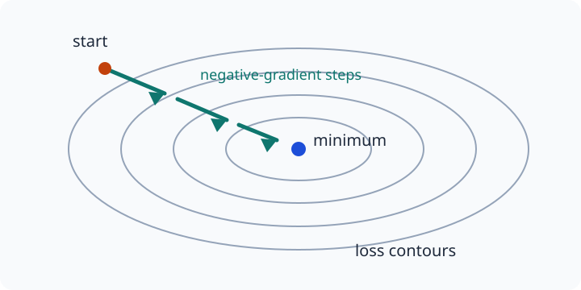

# Lesson 1: Gradient Descent and Learning-Rate Choice
*ML / M05 — Optimizer*

## The question

Given a differentiable loss $f(\theta)$, how can we repeatedly change the
parameters $\theta$ so that the loss gets smaller? And how large should each
change be?

## Learning goals

By the end of this lesson, you should be able to:

1. derive and implement the gradient-descent update;
2. explain why the negative gradient is a downhill direction;
3. connect a quadratic loss's Hessian eigenvalues to a safe learning rate; and
4. diagnose learning rates that are too small or too large from a loss trace.

## 1. From slope to an update rule

At a current parameter vector $\theta$, the first-order Taylor approximation
predicts the loss after a small proposed change $\Delta\theta$:

$$
f(\theta+\Delta\theta)\approx f(\theta)+\nabla f(\theta)^T\Delta\theta.
$$

If we choose $\Delta\theta=-\eta\nabla f(\theta)$ for some $\eta>0$, the
linear term becomes

$$
\nabla f(\theta)^T\Delta\theta=-\eta\|\nabla f(\theta)\|^2\le0.
$$

Thus the negative gradient is the direction of steepest local decrease. The
positive number $\eta$ is the **learning rate**, and the update is

$$
\boxed{\theta_{t+1}=\theta_t-\eta\nabla f(\theta_t).}
$$

## 2. A one-dimensional example

**Example (Quadratic update).** Minimize $f(x)=3x^2$ starting at $x_0=4$ with
$\eta=0.1$.

**Solution:**

Since $f'(x)=6x$, gradient descent gives

$$
x_{t+1}=x_t-0.1(6x_t)=0.4x_t.
$$

Therefore $x_1=1.6$, $x_2=0.64$, and every step moves $x_t$ closer to the
minimizer $x_*=0$.

$\square$

~~~python
import numpy as np

x = np.array([4.0])
lr = 0.1
for step in range(20):
    grad = 6 * x
    x = x - lr * grad
    print(step, x.item(), (3 * x**2).item())
~~~

Compute a gradient at the current parameters, then update all parameters from
that gradient. For vectors, do not update coordinate 1 before using it to
calculate coordinate 2's gradient.

## 3. Curvature gives a theoretical safe rate

Consider the quadratic $f(\theta)=\frac12\theta^TH\theta$, where $H$ is
symmetric positive definite. Its gradient is $H\theta$, so

$$
\theta_{t+1}=(I-\eta H)\theta_t.
$$

Along an eigenvector with eigenvalue $\lambda$, this becomes

$$
z_{t+1}=(1-\eta\lambda)z_t.
$$

For convergence in every eigen-direction, we need

$$
|1-\eta\lambda|<1,
\qquad\text{so }0<\eta<\frac{2}{\lambda_{\max}(H)}.
$$

The conservative choice

$$
\boxed{\eta=\frac{1}{\lambda_{\max}(H)}}
$$

is a **safe monotone-descent step** for this quadratic. More generally, if the
gradient is $L$-Lipschitz, then $\eta\le1/L$ guarantees the standard descent
bound. It is sufficient, not uniquely fastest: for an exact quadratic, some
rates between $1/L$ and $2/L$ still converge but may oscillate.

## 4. What the loss curve is telling us

| Observation | Likely issue | First response |
|---|---|---|
| Loss decreases, but barely changes | Rate too small | Try a rate 2–10 times larger. |
| Loss falls smoothly | Reasonable rate | Continue and compare nearby rates. |
| Loss jumps up and down | Rate too large for some direction | Lower the rate. |
| Loss becomes huge, `inf`, or `nan` | Usually too large, or invalid data | Check data/shapes, then lower it substantially. |

In neural networks we rarely compute the full Hessian or its largest
eigenvalue. Instead, run short controlled experiments: keep model, data split,
seed, and update budget fixed; inspect the loss; and adjust the rate.

## 5. A minimal full-batch implementation

For mean-squared linear regression,

$$
\hat y=Xw+b,\qquad L(w,b)=\frac1n\sum_i(\hat y_i-y_i)^2,
$$

the gradients are

$$
\nabla_wL=\frac2nX^T(\hat y-y),\qquad
\frac{\partial L}{\partial b}=\frac2n\sum_i(\hat y_i-y_i).
$$

~~~python
def mse_and_grads(X, y, w, b):
    residual = X @ w + b - y
    return (residual ** 2).mean(), 2 / len(X) * X.T @ residual, 2 * residual.mean()

w = np.zeros(X.shape[1])
b = 0.0
for step in range(1_000):
    loss, grad_w, grad_b = mse_and_grads(X_train, y_train, w, b)
    w -= 0.05 * grad_w
    b -= 0.05 * grad_b
~~~

Use validation loss—not only training loss—when selecting a final model.

## Key takeaways

- Gradient descent subtracts the current gradient.
- The learning rate is a scale on that update.
- For a quadratic, $1/\lambda_{\max}(H)$ is conservative and safe; the broader
  stability interval is $0<\eta<2/\lambda_{\max}(H)$.
- In realistic networks, choose and adjust rates with controlled experiments.
