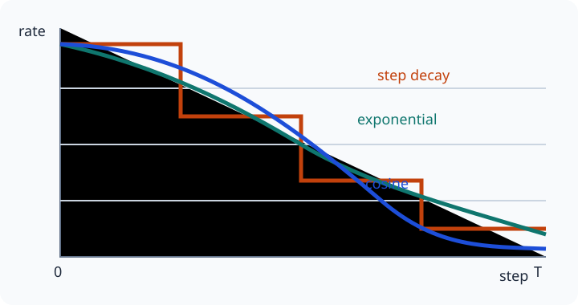

# Lesson 3: Dynamic Learning-Rate Schedules
*ML / M05 — Optimizer*

## The question

A fixed learning rate makes one compromise: large steps explore quickly but can
miss a narrow minimum; small steps refine carefully but can take a long time.
A **learning-rate schedule** makes the rate $\eta_t$ depend on training step
$t$.

## Learning goals

By the end of this lesson, you should be able to implement step, exponential,
and cosine schedules; distinguish their behavior; and insert a time-varying
rate into manual gradient descent.

## 1. The update stays the same

Only the rate changes:

$$
\boxed{\theta_{t+1}=\theta_t-\eta_t\nabla f(\theta_t).}
$$

Decaying $\eta_t$ does not fix a wrong gradient. It is useful after the model
has found a productive region: early updates move broadly, while later ones
make smaller corrections. Define the schedule in **optimizer steps**, not
ambiguously in “time.”

## 2. Step decay and smooth exponential decay

Step decay reduces the rate by factor $\gamma$ every $k$ steps:

$$
\boxed{\eta_t=\eta_0\gamma^{\lfloor t/k\rfloor}},
\qquad 0<\gamma<1.
$$

For example, $\eta_0=0.1$, $\gamma=0.1$, and $k=1{,}000$ gives $0.1$, $0.01$,
and $0.001$ in the first three intervals. It is simple, but its abrupt drops
can be arbitrary.

A smooth exponential decay uses

$$
\boxed{\eta_t=\eta_0e^{-ct}}
$$

or equivalently $\eta_t=\eta_0\gamma^{t/k}$ when the rate should be
multiplied by $\gamma$ over $k$ steps.

~~~python
def step_decay(step, initial_lr, gamma=0.1, every=1_000):
    return initial_lr * gamma ** (step // every)

def exponential_decay(step, initial_lr, gamma=0.1, every=1_000):
    return initial_lr * gamma ** (step / every)
~~~

## 3. Cosine decay

Cosine decay lowers the rate smoothly from $\eta_{\max}$ to $\eta_{\min}$
over a chosen horizon $T$:

$$
\boxed{\eta_t=\eta_{\min}+\frac12(\eta_{\max}-\eta_{\min})
\left(1+\cos\left(\frac{\pi t}{T}\right)\right)},
\qquad 0\le t\le T.
$$

It starts and ends gently. After $T$, either stop training, hold at
$\eta_{\min}$, or deliberately use a restart policy; do not silently let the
cosine rise again unless a restart is intended.

## 4. Put a schedule in a manual loop

~~~python
def cosine_decay(step, max_lr, min_lr, total_steps):
    progress = min(step, total_steps) / total_steps
    return min_lr + 0.5 * (max_lr - min_lr) * (1 + np.cos(np.pi * progress))

for step in range(total_steps):
    lr = cosine_decay(step, max_lr=0.1, min_lr=0.001, total_steps=total_steps)
    loss, grad_w, grad_b = mse_and_grads(X_train, y_train, w, b)
    w -= lr * grad_w
    b -= lr * grad_b
~~~

Log the current rate beside the loss. A late plateau might mean that training
is near a minimum, or simply that the schedule has made updates tiny.

## 5. Choosing a schedule in practice

| Schedule | Useful when | Main caution |
|---|---|---|
| Constant rate | Baselines and short experiments | May keep bouncing near a minimum. |
| Step decay | You have meaningful training milestones | Drop locations and factors need tuning. |
| Smooth exponential | You want steady, simple reduction | It can decay too quickly. |
| Cosine decay | You know a training budget | Its endpoint depends on the planned updates. |

Compare schedules fairly: use the same initialization, data order, total
updates, and initial maximum rate. Examine validation loss and the speed at
which it reached that loss.

## Key takeaways

- A schedule supplies $\eta_t$ to the same gradient-descent update.
- Step decay changes rate in intervals; exponential and cosine decay are smooth.
- State whether the clock advances per batch, epoch, or optimizer update.
- A schedule is a hyperparameter to test, not a universal cure.
