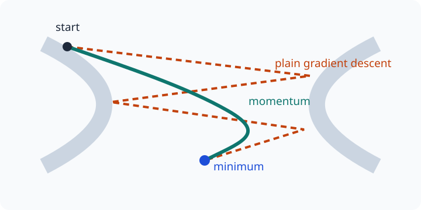

# Lesson 4: Momentum, Nesterov Momentum, and Adam
*ML / M05 — Optimizer*

## The question

Plain gradient descent only sees the current gradient. Can an optimizer use
recent history to smooth noisy updates, travel efficiently through a narrow
valley, or scale updates differently for different parameters?

## Learning goals

By the end of this lesson, you should be able to implement classical momentum,
Nesterov momentum, and Adam; identify the state each method stores; and explain
why Adam needs bias correction at early steps.

## 1. Classical momentum: mix old motion with a new gradient

Classical momentum stores a velocity vector $v$, initialized to zero:

$$
\boxed{v_{t+1}=\beta v_t+g_t,\qquad
\theta_{t+1}=\theta_t-\eta v_{t+1},}
$$

where $g_t=\nabla f(\theta_t)$ and $0\le\beta<1$. The new velocity blends
past velocity with the new gradient. Repeated gradients in a consistent
direction accumulate; alternating gradients partly cancel. A common starting
value is $\beta=0.9$.

~~~python
velocity_w = np.zeros_like(w)
velocity_b = 0.0
for step in range(total_steps):
    loss, grad_w, grad_b = mse_and_grads(X, y, w, b)
    velocity_w = beta * velocity_w + grad_w
    velocity_b = beta * velocity_b + grad_b
    w -= lr * velocity_w
    b -= lr * velocity_b
~~~

Some references define velocity with the negative gradient and then add it to
parameters. Both conventions work; write the equations and keep their signs
consistent.

## 2. Nesterov momentum: look ahead, then measure

Nesterov accelerated gradient first looks in the direction momentum would take,
then evaluates the gradient at that look-ahead point:

$$
\tilde\theta_t=\theta_t-\eta\beta v_t,
$$

$$
\boxed{v_{t+1}=\beta v_t+\nabla f(\tilde\theta_t),\qquad
\theta_{t+1}=\theta_t-\eta v_{t+1}.}
$$

This advance warning can correct velocity that would overshoot a turn in the
loss surface. It requires a gradient function that accepts a candidate
parameter vector, not only the stored current vector.

## 3. Adam: momentum plus adaptive scaling

Let $g_t=\nabla f(\theta_t)$ be the gradient of the loss at the current
parameters. Adam maintains exponentially weighted first moment $m$ and second
moment $s$:

$$
m_t=\beta_1m_{t-1}+(1-\beta_1)g_t,
\qquad
s_t=\beta_2s_{t-1}+(1-\beta_2)g_t\odot g_t.
$$

Here $\odot$ means an **elementwise product**: if
$g_t=[g_{t,1},\ldots,g_{t,d}]^T$, then

$$
g_t\odot g_t=[g_{t,1}^2,\ldots,g_{t,d}^2]^T.
$$

This is the same operation as the NumPy expressions "grad ** 2" or
"grad * grad" for an array. It is not the scalar squared norm
$\lVert g_t\rVert^2$, which sums
the squared entries. Adam keeps one second-moment estimate per parameter.

Both states start at zero, so early values are biased toward zero. Adam
corrects them:

$$
\hat m_t=\frac{m_t}{1-\beta_1^t},
\qquad
\hat s_t=\frac{s_t}{1-\beta_2^t},
$$

and updates elementwise:

$$
\boxed{\theta_t=\theta_{t-1}-\eta
\frac{\hat m_t}{\sqrt{\hat s_t}+\epsilon}.}
$$

Typical initial settings are $\beta_1=0.9$, $\beta_2=0.999$, and
$\epsilon=10^{-8}$, but the learning rate remains important. Parameters with
persistently large squared gradients receive smaller effective steps.

~~~python
m_w = np.zeros_like(w); s_w = np.zeros_like(w)
m_b = 0.0;              s_b = 0.0
for t in range(1, total_steps + 1):
    loss, grad_w, grad_b = mse_and_grads(X, y, w, b)
    m_w = beta1 * m_w + (1 - beta1) * grad_w
    s_w = beta2 * s_w + (1 - beta2) * grad_w**2
    m_b = beta1 * m_b + (1 - beta1) * grad_b
    s_b = beta2 * s_b + (1 - beta2) * grad_b**2
    m_w_hat, s_w_hat = m_w / (1 - beta1**t), s_w / (1 - beta2**t)
    m_b_hat, s_b_hat = m_b / (1 - beta1**t), s_b / (1 - beta2**t)
    w -= lr * m_w_hat / (np.sqrt(s_w_hat) + eps)
    b -= lr * m_b_hat / (np.sqrt(s_b_hat) + eps)
~~~

## 4. What to compare

| Method | Stored state per parameter | Main strength | Main risk |
|---|---|---|---|
| Gradient descent | None | Simple, transparent baseline | Zigzags in ill-conditioned valleys. |
| Momentum | One velocity | Accelerates consistent directions | Can overshoot. |
| Nesterov | One velocity plus look-ahead gradient | Anticipates a turn | Easy to evaluate at the wrong point. |
| Adam | First and second moments | Per-coordinate scaling | Needs correct bias correction. |

Compare with the same data order, initialization, update count, and validation
criterion. Log loss and, when useful, parameter or gradient norms.

## Key takeaways

- Momentum blends historical velocity with the current gradient.
- Nesterov evaluates the gradient at a momentum look-ahead point.
- Adam uses gradient and squared-gradient averages with bias correction.
- Optimizers do not remove the need to tune rates and validate results.
