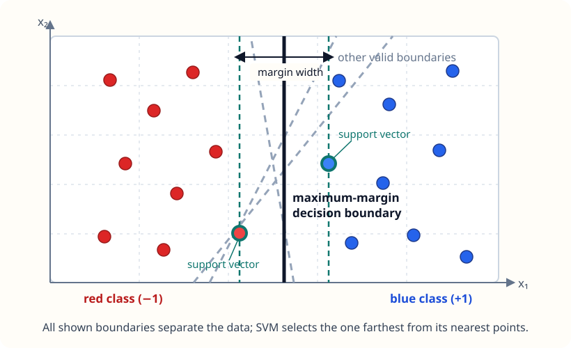

# Lesson 1: From a Separating Line to Soft-Margin SVM
*ML / M06 — Supervised Learning*

## The question

Given binary training examples $(\mathbf x_i,y_i)$, how can we choose a
linear decision boundary that not only separates the two classes, but does so
with room to spare? And what should we do when perfect separation is
impossible?

## 1. A linear classifier has many separating boundaries

Let

$$
f(\mathbf x)=\mathbf w^T\mathbf x+b,
\qquad
\hat y=\operatorname{sign}(f(\mathbf x)),
$$

where $\mathbf w$ is the normal vector to the decision boundary
$\mathbf w^T\mathbf x+b=0$. A point is classified correctly exactly when

$$
y_i(\mathbf w^T\mathbf x_i+b)>0.
$$

If the data are linearly separable, many $(\mathbf w,b)$ pairs satisfy that
condition. SVM chooses among them by maximizing the **margin**: the distance
from the boundary to the closest training points.

The dashed gray lines all separate the red and blue training points. The dark
vertical line is preferable because its nearest points are farther away than
for the alternatives. The two dashed teal lines meet those nearest points;
they bound the maximum-margin region.

Multiplying both $\mathbf w$ and $b$ by a positive constant does not change
the boundary, so we fix a convenient scale. Require the closest correctly
classified points to satisfy

$$
y_i(\mathbf w^T\mathbf x_i+b)\geq1.
$$

The two supporting hyperplanes are then

$$
\mathbf w^T\mathbf x+b=1
\quad\text{and}\quad
\mathbf w^T\mathbf x+b=-1.
$$

Their distance is $2/\lVert\mathbf w\rVert_2$. Thus maximizing the margin
is the same as minimizing $\tfrac12\lVert\mathbf w\rVert_2^2$.

## 2. The hard-margin optimization problem

For perfectly separable data, the original SVM is

$$
\boxed{
\begin{aligned}
\underset{\mathbf w,b}{\operatorname{minimize}}\quad
&\frac12\lVert\mathbf w\rVert_2^2\\
\text{subject to}\quad
&y_i(\mathbf w^T\mathbf x_i+b)\geq1,
&&i=1,\ldots,n.
\end{aligned}}
$$

This is a convex quadratic optimization problem with linear constraints.
Points that attain equality are **support vectors**. They lie on a margin
boundary and determine the fitted boundary; moving a training point far from
the margin usually does not change the solution.

The hard-margin formulation has one serious weakness: a single mislabeled
point, outlier, or overlapping pair of classes can make the constraints
infeasible. Real data nearly always have one of those problems.

## 3. Allow violations with slack variables

Introduce one slack variable $\xi_i\geq0$ per example:

$$
y_i(\mathbf w^T\mathbf x_i+b)\geq1-\xi_i.
$$

Its value describes the violation:

| Value of $\xi_i$ | Meaning |
| --- | --- |
| $0$ | Correctly classified and on or outside the margin. |
| $0<\xi_i\leq1$ | Correct, but inside the margin. |
| $\xi_i>1$ | Misclassified. |

The **soft-margin SVM** trades a wide margin against these violations:

$$
\boxed{
\begin{aligned}
\underset{\mathbf w,b,\boldsymbol\xi}{\operatorname{minimize}}\quad
&\frac12\lVert\mathbf w\rVert_2^2+C\sum_{i=1}^n\xi_i\\
\text{subject to}\quad
&y_i(\mathbf w^T\mathbf x_i+b)\geq1-\xi_i,
&&i=1,\ldots,n,\\
&\xi_i\geq0,
&&i=1,\ldots,n.
\end{aligned}}
$$

Equivalently, after minimizing over the slack variables, it minimizes

$$
\frac12\lVert\mathbf w\rVert_2^2+
C\sum_{i=1}^n\max\bigl(0,\,1-y_i(\mathbf w^T\mathbf x_i+b)\bigr).
$$

The second term is the **hinge loss**.

## 4. What $C$ means

$C$ is the cost placed on training-margin violations relative to keeping
$\mathbf w$ small.

- A **small $C$** makes violations comparatively cheap. The model accepts
  more training errors or margin intrusions to favor a wider margin. This is
  stronger regularization.
- A **large $C$** makes violations expensive. The model tries harder to fit
  every training example, producing weaker regularization and greater
  sensitivity to outliers.

This direction is deliberately the reverse of the coefficient convention in
ridge or lasso. There, a larger $\lambda$ multiplies the penalty and means
stronger regularization. In this SVM objective, $C$ multiplies the data-fit
(hinge-loss) term, so a smaller $C$ means stronger regularization.

A useful mental model is that hard-margin SVM is the $C\to\infty$ limit of
soft-margin SVM: any violation has infinite cost. For separable data this
recovers the hard-margin solution. It is best understood as a limiting
statement—not as a finite numeric value one should pass to software.

## Key takeaways

- Hard-margin SVM maximizes the geometric margin while requiring every point
  to be correctly classified.
- Soft-margin SVM uses slack variables and hinge loss so that noisy or
  overlapping data remain solvable.
- Smaller $C$ means stronger regularization; larger $C$ emphasizes training
  fit.
- Support vectors are the training points on, inside, or beyond the margin
  that matter to the fitted boundary.

