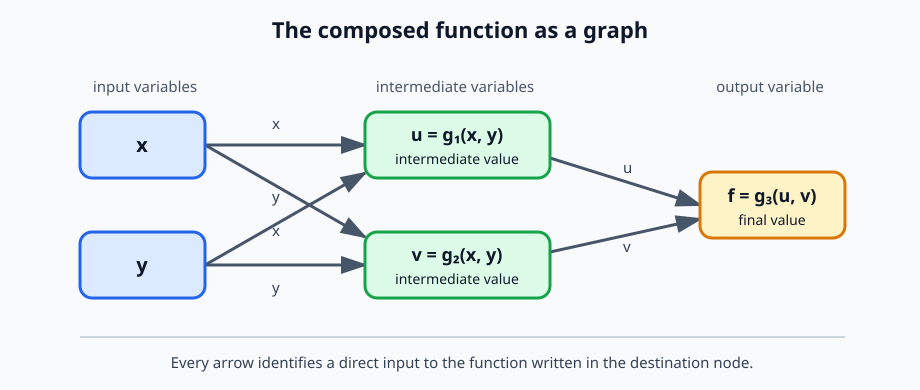
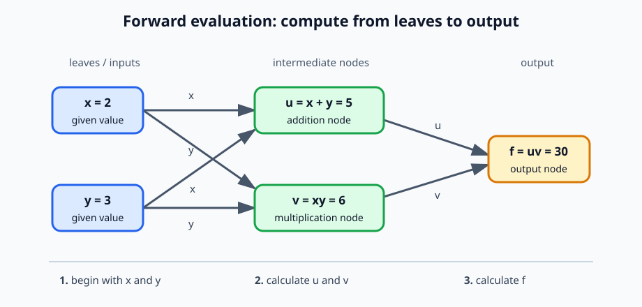
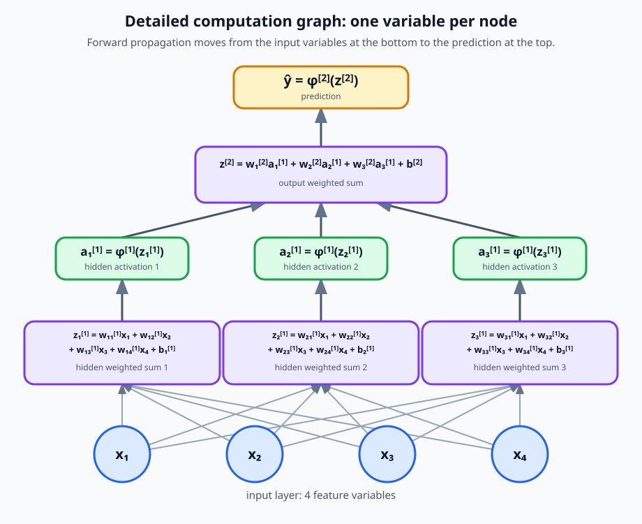
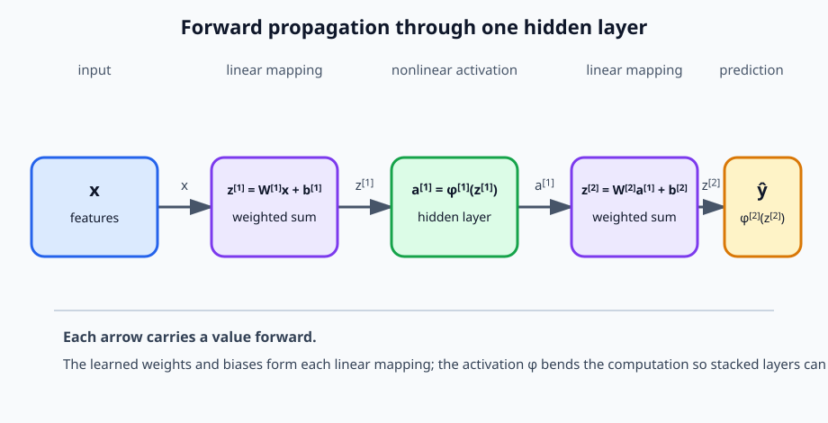
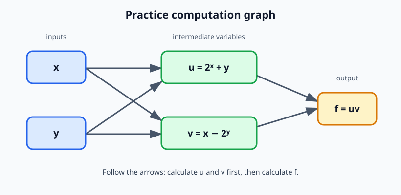

# Lesson 1: Function Composition, Computation Graphs, and Forward Propagation
*ML / M06 — Supervised Learning*

## The question

A neural network is often drawn as circles joined by arrows. What do those
circles and arrows mean mathematically, and how is a prediction calculated from
input values?

A neural network is a function built by composing smaller functions. Its
picture is a **directed acyclic computation graph**, and **forward
propagation** is the evaluation of that graph from inputs to output.

## 1. Start with function composition

A function takes an input and produces an output. If the output of one function
becomes the input of another, we compose them:

$$
u=g(x),\qquad f(x)=h(u)=h(g(x)).
$$

The symbol $u$ is an **intermediate variable**: it names a value needed on the
way from $x$ to $f(x)$. Writing it explicitly reveals the multi-step
calculation.

With several inputs and intermediate variables, write local relations:

$$
\begin{aligned}
u &= g_1(x,y),\\
v &= g_2(x,y),\\
f &= g_3(u,v).
\end{aligned}
$$

Together, these equations define one function of the original inputs:

$$
f(x,y)=g_3\bigl(g_1(x,y),g_2(x,y)\bigr).
$$

The final output is assembled from simpler functions rather than calculated in
one mysterious jump.

## 2. Variables become nodes; direct relations become edges

A **computation graph** is a picture of these equations.

- Each variable is a **node**. Inputs are leaf nodes, the final value is an
  output node, and the remaining variables are intermediate nodes.
- A directed **edge** points from a variable used by a calculation to the
  variable that calculation produces. Thus $u=g_1(x,y)$ has edges
  $x\rightarrow u$ and $y\rightarrow u$.
- The operation at a node tells us how to calculate it from incoming values.

For the relations from Section 1, the nodes are $x$, $y$, $u$, $v$, and $f$.
The arrows show exactly which variables each local function uses:

The graph is **acyclic**: following arrows can never bring us back to a node
already visited. A cycle would make a value depend on itself, directly or
indirectly, so an ordinary one-pass calculation from known inputs would not be
possible. A neural network is such a directed acyclic computation graph for
one composed function.

## 3. Forward propagation: calculate from leaves to output

Consider

$$
\begin{aligned}
u &= x+y,\\
v &= xy,\\
f &= uv.
\end{aligned}
$$

This is the composed function $f(x,y)=(x+y)(xy)$. The graph shows both the
dependencies and the forward-propagation order.

For $x=2$ and $y=3$, calculate upward from leaves to output:

$$
\begin{aligned}
x&=2, & y&=3,\\
u&=x+y=2+3=5, & v&=xy=2\cdot3=6,\\
f&=uv=5\cdot6=30.
\end{aligned}
$$

This is forward propagation: evaluate each node after the nodes feeding into
it have values. Here $u$ and $v$ can be calculated independently once $x$ and
$y$ are known. Likewise, a neural-network layer can evaluate many nodes in
parallel.

## 4. The ingredients of a neural network

Neural networks choose particular local functions for their graph nodes. The
usual pattern is a learned linear mapping followed by a nonlinear activation.

### 4.1 Neuron: a linear mapping

A neuron receives $\mathbf x\in\mathbb R^d$ and computes

$$
z=\mathbf w^T\mathbf x+b
=w_1x_1+\cdots+w_dx_d+b.
$$

This is an affine linear mapping. The weights $\mathbf w$ and bias $b$ are
parameters that learning will choose from data.

A layer of $h$ neurons computes $h$ expressions at once:

$$
\mathbf z=W\mathbf x+\mathbf b,
\qquad
W\in\mathbb R^{h\times d},\quad
\mathbf b\in\mathbb R^h.
$$

Each component of $\mathbf z$ is a node in the graph. The entries of
$\mathbf x$ connect to each neuron through weighted edges, and every neuron
adds its own bias.

### 4.2 Activation: a nonlinear function

Apply an activation function coordinate by coordinate:

$$
\mathbf a=\phi(\mathbf z).
$$

Then $\mathbf a$ becomes input to the next layer. A one-hidden-layer network is

$$
\hat y
= \phi^{[2]}\!\left(
W^{[2]}\,
\phi^{[1]}\!\left(W^{[1]}\mathbf x+\mathbf b^{[1]}\right)
+\mathbf b^{[2]}
\right).
$$

Note: here the superscript [1] [2] are the labels indicating the layers, not exponents.
 

For most of the cases, we won't expand the whole details of the linear mapping when illustrating the graph map, but compress the whole flow as:

This is the whole neural network as a single composed function. Its graph
makes the intermediate variables and dependencies visible.

## 5. Why nonlinearity is necessary

If every layer were linear, two layers would collapse into one:

$$
W^{[2]}\bigl(W^{[1]}\mathbf x+\mathbf b^{[1]}\bigr)+\mathbf b^{[2]}
=
\underbrace{W^{[2]}W^{[1]}}_{W'}\mathbf x+
\underbrace{W^{[2]}\mathbf b^{[1]}+\mathbf b^{[2]}}_{\mathbf b'}.
$$

No matter how many purely linear layers are stacked, they represent only one
affine linear map $W'\mathbf x+\mathbf b'$. Extra linear layers alone cannot
represent new kinds of relationships.

Nonlinear activations prevent that collapse. Their compositions let a network
create thresholds, bends, and more complicated decision boundaries.

| Activation | Definition | Common use |
| --- | --- | --- |
| ReLU | $\text{ReLU}(z)=\max(0,z)$ | Default hidden-layer activation. |
| Sigmoid | $\sigma(z)=1/(1+e^{-z})$ | Binary-classification output. |
| Tanh | $\tanh(z)=(e^z-e^{-z})/(e^z+e^{-z})$ | Zero-centered hidden activation. |
| Softmax | $\text{softmax}(\mathbf z)_j=e^{z_j}/\sum_k e^{z_k}$ | Multiclass output probabilities. |

ReLU is nonlinear because its rule changes at $z=0$: negative values become
zero, while positive values pass through. Sigmoid and tanh smoothly bend their
inputs. Softmax couples output nodes so their values are positive and sum to
one.

## 6. The Multilayer Perceptron

MLP (Multilayer Perceptron) is the fundamental neural network that we build
 the neural network by layers, and each layer is an activation on top of 
 linear mapping from the previous layer.

Let $\mathbf a^{[0]}=\mathbf x$. A network with layers
$\ell=1,\ldots,L$ evaluates

$$
\boxed{
\begin{aligned}
\mathbf z^{[\ell]}&=W^{[\ell]}\mathbf a^{[\ell-1]}+\mathbf b^{[\ell]},\\
\mathbf a^{[\ell]}&=\phi^{[\ell]}\!\left(\mathbf z^{[\ell]}\right).
\end{aligned}}
$$

The final activation $\mathbf a^{[L]}$ is the prediction. In some
implementations, the final pre-activation $\mathbf z^{[L]}$ instead goes
directly to a loss function. Either way, forward propagation is repeated local
evaluation in a valid input-to-output order.

## 7. Other common neural-network structures

An MLP connects each layer densely to the next one. Other neural-network
structures keep the same forward-propagation idea but choose connections that
match the structure of their input.

| Structure | Main idea | Common application |
| --- | --- | --- |
| Convolutional neural network (CNN) | Small learned filters slide across nearby input values, reusing the same weights at many locations. | Images and other grid-like data. |
| Transformer | An attention mechanism lets each token weigh information from other relevant tokens in the sequence. | Natural-language processing; also widely used for vision and multimodal data. |

For example, a CNN can detect the same edge or texture anywhere in an image,
while a Transformer can connect words that are far apart in a sentence. We
will not study these architectures in detail here; the central idea remains the
same: calculate each intermediate value in a valid forward order to produce a
prediction.

## Class practice

### Type 1: Equations to a computation graph

Let the intermediate variables and output be

$$
u=2x-y,\qquad v=\text{ReLU}(u),\qquad f=3v+1.
$$

1. Draw the computation graph. Include a node for each variable and an arrow
   for each dependency.
2. Simulate forward propagation for both input pairs:
   $(x,y)=(1,4)$ and $(x,y)=(3,1)$. Record $u$, $v$, and $f$ for each pair.

Solution

1. The input leaves $x$ and $y$ point to $u$; $u$ points to $v$; and $v$
   points to $f$.
2. For $(1,4)$: $u=-2$, $v=0$, $f=1$. For $(3,1)$: $u=5$, $v=5$,
   $f=16$.

### Type 2: A computation graph to a composed function

Study this graph:

1. Write the final output as one composed function $f(x,y)$, with no
   intermediate variables.
2. Simulate forward propagation for both input pairs:
   $(x,y)=(2,1)$ and $(x,y)=(1,4)$. Record $u$, $v$, and $f$ for each pair.

Solution

1. $f(x,y)=(2^x+y)(x-2^y)$.
2. For $(2,1)$: $u=5$, $v=0$, $f=0$. For $(1,4)$: $u=6$, $v=-15$,
   $f=-90$.

## Key takeaways

- A neural network is a composed function, not a collection of unexplained
  circles.
- Intermediate variables are graph nodes; direct functional dependencies are
  directed edges.
- Acyclic graphs can be evaluated from inputs to output by forward propagation.
- Neural-network layers alternate learned linear maps and nonlinear
  activations.
- Nonlinearity keeps a multilayer network from collapsing into one linear
  model.

Next, we will use a loss function to measure the difference between a network
prediction and a target value.
