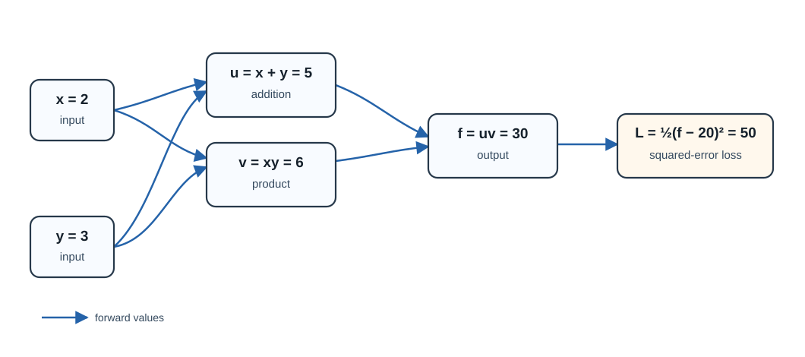
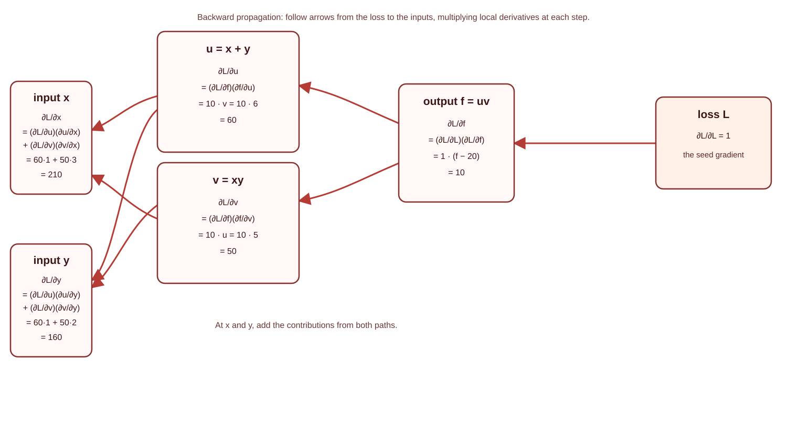

# Lesson 2: Loss Gradients and Backpropagation
*ML / M06 — Supervised Learning*

## The question

Forward propagation tells a neural network how to turn inputs into a
prediction. How does the network determine which weight or bias should change
to make that prediction better?

**Backpropagation** efficiently computes the derivative of the loss with
respect to every learnable parameter. It applies the chain rule from the loss
back through a computation graph, reusing partial derivatives along the way.

## 1. Learning needs a score: the loss

For one training example with target $y$ and prediction $\hat y$, a loss
function assigns a number that measures their mismatch. For a regression
problem, a common choice is squared error:

$$
\mathcal L(\hat y,y)=\frac12(\hat y-y)^2.
$$

The factor $\frac12$ is convenient because it cancels when differentiating:

$$
\frac{\partial \mathcal L}{\partial \hat y}=\hat y-y.
$$

If $\hat y$ is too large, this derivative is positive; decreasing $\hat y$
will decrease the loss. If $\hat y$ is too small, it is negative; increasing
$\hat y$ will decrease the loss.

A parameter $\theta$ affects the loss indirectly through the network's
prediction. The derivative

$$
\frac{\partial \mathcal L}{\partial \theta}
$$

therefore tells us how a small change to that parameter changes the loss.
Gradient descent uses it to update the parameter:

$$
\theta\leftarrow\theta-\eta\frac{\partial\mathcal L}{\partial\theta},
$$

where $\eta>0$ is the learning rate. The update goes in the direction
opposite the gradient because the gradient points toward increasing loss.

Now the question is that in case $L$ depends on $\theta$ by a complicated neural
network, how can we find the derivative?

## 2. The chain rule is the route backward

Suppose values are related by

$$
x\longrightarrow u=g(x)\longrightarrow f=h(u)\longrightarrow\mathcal L.
$$

Recall the calculus tells the chain rule for derivatives:

$$
\frac{\partial\mathcal L}{\partial x}
=\frac{\partial\mathcal L}{\partial f}
 \frac{\partial f}{\partial u}
 \frac{\partial u}{\partial x}.
$$

During a backward pass, a node receives its **upstream gradient**,
$\partial\mathcal L/\partial f$, from the node after it. It multiplies by
its local derivative, $\partial f/\partial u$, to send a gradient to the node
before it.

If a variable feeds more than one later computation, it has more than one
route to the loss. Its total gradient is the sum of the contributions from all
routes:

$$
\frac{\partial\mathcal L}{\partial x}
=\sum_{y \text{ depends on } x \text{ directly}}
 \frac{\partial L}{\partial y} \frac{\partial y}{\partial x}.
$$

This accumulation rule is essential: a shared input or parameter must receive
credit (or blame) from every operation that used it.

More specifically this is what we are going to do:

1. At each node, store the derivative of root function with respect to this node variable. Namely,  on node $x$, we store $\frac{\partial L}{ \partial x}$.

2. Unlike previously we calculate function value that we should start from the leaf nodes to the root. This time we start from the root that we have $\frac{\partial L}{\partial L}=1$.

3. At node $x$, let's assume that nodes $y_1$, $y_2$ ... $y_k$ are the direct functions
of $x$, and further assume that $\frac{\partial L}{\partial y_i}$ are already calculated. Then we can use the following formula:

$$
\frac{\partial L}{\partial x} = \sum_{i=1}^k \frac{\partial L}{\partial y_i} \frac{\partial y_i}{\partial x}
$$

## 3. A small computation graph, forward and backward

Consider the graph

$$
u=x+y,\qquad v=xy,\qquad f=uv,\qquad
\mathcal L=\frac12(f-t)^2.
$$

For $x=2$, $y=3$, and target $t=20$, forward propagation gives

$$
u=5,\qquad v=6,\qquad f=30,\qquad \mathcal L=50.
$$

First evaluate the graph from inputs to the loss. This forward graph contains
only values, so its calculation order is easy to follow.

Then start at the loss and trace dependencies in reverse. This separate graph
shows the chain-rule calculation written at each node.

## 4. Commonly used activation function derivatives

For familiar activations,

$$
\begin{aligned}
\text{ReLU}'(z)&=
\begin{cases}1&z>0 \\ 0&z<0 \end{cases},\\
\sigma'(z)&=\sigma(z)(1-\sigma(z)),\\
\tanh'(z)&=1-\tanh^2(z).
\end{aligned}
$$

ReLU is not differentiable at $z=0$. In practice, software chooses a
subgradient there, commonly $0$. This single point rarely matters for
continuous-valued training data and parameters.

## 5. Example: Backpropagation through one neuron

Take one neuron with a ReLU activation:

$$
z=wx+b,\qquad a=\text{ReLU}(z),\qquad
\mathcal L=\frac12(a-y)^2.
$$

Read the graph from right to left. First calculate the output error, then
carry it through the activation and the affine mapping:

$$
\begin{aligned}
\frac{\partial\mathcal L}{\partial a}&=a-y,\\
\frac{\partial\mathcal L}{\partial z}&=(a-y)\text{ReLU}'(z),\\
\frac{\partial\mathcal L}{\partial w}&=
\frac{\partial\mathcal L}{\partial z}\,x,\\
\frac{\partial\mathcal L}{\partial b}&=
\frac{\partial\mathcal L}{\partial z},\\
\frac{\partial\mathcal L}{\partial x}&=
\frac{\partial\mathcal L}{\partial z}\,w.
\end{aligned}
$$

The weight gradient has an intuitive form: it is the neuron's local error
signal, $\partial\mathcal L/\partial z$, multiplied by the input that flowed
through that weight. A bias has no input multiplier because it is added
directly.

For a neuron that is inactive ($z<0$), the ReLU derivative is zero, so this
example sends zero gradient to $w$, $b$, and $x$. This is one reason poorly
initialized ReLU networks can contain “dead” neurons.

## 6. A useful output-layer shortcut

Some activation-and-loss pairs simplify. For binary classification with a
sigmoid output $\hat y=\sigma(z)$ and binary cross-entropy loss,

$$
\mathcal L=-\bigl[y\log\hat y+(1-y)\log(1-\hat y)\bigr],
$$

the activation derivative and loss derivative combine to give

$$
\frac{\partial\mathcal L}{\partial z}=\hat y-y.
$$

Try to derive the proof by yourself and note that $y$ is constant.

This is the derivative with respect to the output **logit** $z$, not
necessarily with respect to $\hat y$. A softmax output with multiclass
cross-entropy has the analogous vector result
$d\mathbf z=\hat{\mathbf y}-\mathbf y$.

## Class practice

### Type 1: Trace a backward pass

Let

$$
u=2x-y,\qquad v=u^2,\qquad \mathcal L=\frac12(v-5)^2.
$$

At $(x,y)=(2,1)$:

1. Draw the graph for this network.
2. Calculate $u$, $v$, and $\mathcal L$ by forward propagation.
3. Calculate $\partial\mathcal L/\partial v$,
   $\partial\mathcal L/\partial u$,
   $\partial\mathcal L/\partial x$, and
   $\partial\mathcal L/\partial y$.

Solution

$u=3$, $v=9$, and $\mathcal L=\frac12(4)^2=8$.

$$
\frac{\partial\mathcal L}{\partial v}=4,
\qquad
\frac{\partial\mathcal L}{\partial u}=4(2u)=24.
$$

Since $\partial u/\partial x=2$ and $\partial u/\partial y=-1$,

$$
\frac{\partial\mathcal L}{\partial x}=48,
\qquad
\frac{\partial\mathcal L}{\partial y}=-24.
$$

### Type 2: Gradients of a ReLU neuron

For $z=wx+b$, $a=\text{ReLU}(z)$, and
$\mathcal L=\frac12(a-y)^2$, use

$$
x=2,\qquad w=0.5,\qquad b=-0.5,\qquad y=1.
$$

1. Draw the graph of the network, and remember to make $w$ and $b$ as node as well.
2. Find $z$, $a$, and $\mathcal L$.
3. Find $\partial\mathcal L/\partial w$ and
   $\partial\mathcal L/\partial b$.
4. With learning rate $\eta=0.1$, perform one gradient-descent update. Namely calculate

$$
w_{new} = w - \eta \frac{\partial L}{\partial w}
$$

$$
b_{new} = b - \eta \frac{\partial L}{\partial b}
$$

Solution

$z=0.5$, $a=0.5$, and $\mathcal L=0.125$. Since $z>0$, the ReLU derivative
is $1$.

$$
\frac{\partial\mathcal L}{\partial z}=a-y=-0.5,
\qquad
\frac{\partial\mathcal L}{\partial w}=(-0.5)(2)=-1,
\qquad
\frac{\partial\mathcal L}{\partial b}=-0.5.
$$

Thus $w\leftarrow0.5-0.1(-1)=0.6$ and
$b\leftarrow-0.5-0.1(-0.5)=-0.45$.

## Key takeaways

- A loss gradient measures how changing a value or parameter changes the loss.
- Backpropagation applies the chain rule from the loss back through the
  computation graph.
- Every operation needs only its local derivative; gradients from multiple
  downstream paths are added.
- A layer's parameter gradients are $dW=dZ A_{\mathrm{prev}}^T$ and the
  batch sum of $dZ$ for its bias.
- Backpropagation computes gradients. An optimizer turns them into parameter
  updates.

Next, we will use these gradients to train a neural network on data and study
the choices that make training stable.

